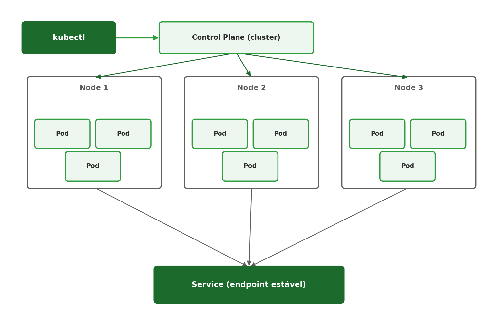

[← Anterior: Checklist geral (Semanas 10 a 18)](../unidade2/19-checklist-unidade2.md) | [Índice](../../README.md) | [Próximo: Referências →](../referencias.md)

# Material complementar (opcional) — Introdução a Kubernetes

> Conteúdo extra, fora do escopo obrigatório da disciplina. Serve como ponte para quem quiser ir além do Docker Compose (Unidade 2) e se aprofundar em orquestração de containers em escala — bom material também para quem for apresentar o tema no seminário.

## Teoria

O Docker Compose funciona bem para orquestrar containers numa única máquina. O **Kubernetes** entra quando é preciso orquestrar containers em **várias máquinas** (um cluster), com recursos como auto-scaling, auto-healing (reinicia containers que caem sozinhos) e atualização de versões sem downtime.



Principais conceitos:

- **Cluster** — o conjunto de máquinas que rodam os containers.
- **Node** — cada máquina do cluster (física ou virtual).
- **Pod** — a menor unidade do Kubernetes: um ou mais containers que rodam juntos, compartilhando rede e armazenamento.
- **Deployment** — declara quantas réplicas de um Pod devem existir, e gerencia atualizações.
- **Service** — expõe um conjunto de Pods como um endereço de rede estável, já que Pods podem morrer e renascer com IPs diferentes.
- **kubectl** — a ferramenta de linha de comando usada para interagir com o cluster.

## Comandos essenciais

Para estudar localmente, sem precisar de um cluster real na nuvem, a opção mais prática no WSL2 (que já tem Docker da Unidade 2) é o **kind** (Kubernetes IN Docker), que roda o cluster inteiro dentro de containers Docker:

```bash
# Instalar o kind
go install sigs.k8s.io/kind@latest

# Criar um cluster local
kind create cluster

# Instalar o kubectl
curl -LO "https://dl.k8s.io/release/$(curl -L -s https://dl.k8s.io/release/stable.txt)/bin/linux/amd64/kubectl"
sudo install kubectl /usr/local/bin/kubectl

# Confirmar que o cluster está no ar
kubectl cluster-info
```

Primeiro exemplo prático — subindo e expondo uma aplicação:

```bash
# Criar um Deployment a partir de uma imagem já existente
kubectl create deployment meu-app --image=nginx

# Expor esse Deployment como um Service
kubectl expose deployment meu-app --port=80 --type=NodePort

# Ver o que está rodando
kubectl get pods
kubectl get deployments
kubectl get services
```

## O jeito declarativo: arquivos YAML

Na prática, em vez de comandos soltos, o estado desejado é descrito em arquivos `.yaml` e aplicado com `kubectl apply`:

```yaml
# deployment.yaml
apiVersion: apps/v1
kind: Deployment
metadata:
  name: meu-app
spec:
  replicas: 3
  selector:
    matchLabels:
      app: meu-app
  template:
    metadata:
      labels:
        app: meu-app
    spec:
      containers:
      - name: meu-app
        image: nginx
        ports:
        - containerPort: 80
```

```bash
kubectl apply -f deployment.yaml
```

Esse é o coração do Kubernetes: você declara **o que quer** (3 réplicas do Nginx rodando), e o cluster se encarrega de manter esse estado — se um Pod cair, outro sobe automaticamente no lugar.

## Exercícios (opcionais)

1. Instale o `kind` e crie um cluster local de um nó.
2. Crie um Deployment do Nginx com `kubectl create deployment` e exponha-o como Service.
3. Escreva o mesmo Deployment em um arquivo `deployment.yaml` e aplique com `kubectl apply -f`.
4. Derrube manualmente um Pod (`kubectl delete pod <nome>`) e observe o Kubernetes recriá-lo automaticamente.
5. Desafio: compare, em texto, o que o `docker-compose.yml` (Semana 12 da Unidade 2) e o `deployment.yaml` do Kubernetes têm em comum e o que é exclusivo de cada um.

---

[← Anterior: Checklist geral (Semanas 10 a 18)](../unidade2/19-checklist-unidade2.md) | [Índice](../../README.md) | [Próximo: Referências →](../referencias.md)
