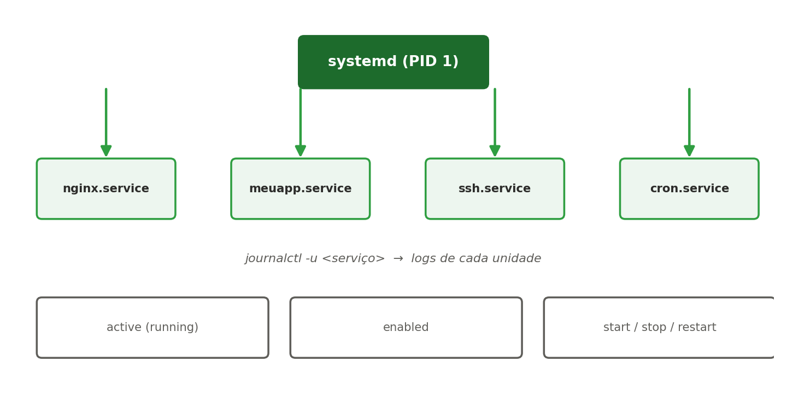

[← Anterior: Preparando o WSL2](00-preparando-wsl2.md) | [Índice](../../README.md) | [Próximo: Complemento: Acesso SSH, rede básica e teste de conectividade →](02-complemento-ssh-e-rede.md)

# Semana 2 — Gerenciamento de processos e serviços

## Teoria — processos

Todo programa em execução no Linux é um **processo**, identificado por um **PID** (Process ID). Todo processo, exceto o primeiro, tem um processo pai — identificado pelo **PPID** — formando uma hierarquia.

**Visualizar processos:**

```bash
# Lista todos os processos do sistema (formato BSD)
ps aux

# Lista todos os processos do sistema (formato padrão UNIX)
ps -ef

# Visão dinâmica, em tempo real, de CPU e memória
top

# Versão mais amigável do top (pode exigir instalação: sudo apt install htop)
htop
```

**PID, PPID e hierarquia de processos:**

```bash
# Mostra a árvore de processos (pai/filho)
pstree

# Mostra a árvore com PIDs
pstree -p
```

**Estados de um processo:** ao rodar `ps aux`, a coluna `STAT` mostra o estado atual:
- `R` — rodando (running)
- `S` — dormindo, aguardando algum evento (sleeping)
- `Z` — zumbi, processo finalizado mas ainda não "limpo" pelo pai (zombie)
- `T` — parado (stopped)

**Sinais e finalização:**

```bash
# Encerramento "educado" — pede para o processo finalizar (SIGTERM)
kill -15 <PID>

# Encerramento forçado — mata o processo imediatamente (SIGKILL)
kill -9 <PID>

# Mata todos os processos com um determinado nome
killall firefox

# Mata processos por padrão de nome/linha de comando
pkill -f http.server
```

> Prefira sempre tentar `kill -15` antes de `kill -9`: o `SIGTERM` permite que o processo finalize tarefas pendentes (salvar arquivos, fechar conexões) antes de encerrar. O `SIGKILL` interrompe na hora, sem chance de limpeza.

**Processos em foreground/background:**

```bash
# Roda um processo em segundo plano (background)
sleep 100 &

# Suspende o processo que está rodando em primeiro plano (foreground)
# Ctrl+Z
```

Quando você aperta `Ctrl+Z`, o processo em foreground é pausado (estado `T`) e devolve o terminal para você — ele continua existindo, mas parado, até ser retomado ou finalizado.

## Teoria — systemd

O **systemd** é o sistema de inicialização (`init`) usado pela maioria das distribuições Linux modernas, incluindo o Ubuntu. Ele é o primeiro processo a rodar (PID 1) e é responsável por iniciar, parar e supervisionar todos os demais serviços (chamados de *units*).



Principais conceitos:
- **Unit**: uma unidade gerenciável pelo systemd (serviço, timer, socket, etc.). Serviços usam a extensão `.service`.
- **Estado de execução**: `active (running)`, `inactive (dead)`, `failed`.
- **Habilitado (enabled)**: o serviço inicia automaticamente no boot, independentemente de estar rodando agora.

## Comandos essenciais — systemd

```bash
# Ver status de um serviço
sudo systemctl status ssh

# Iniciar, parar e reiniciar
sudo systemctl start ssh
sudo systemctl stop ssh
sudo systemctl restart ssh

# Habilitar/desabilitar no boot
sudo systemctl enable ssh
sudo systemctl disable ssh

# Listar todos os serviços ativos
systemctl list-units --type=service --state=running

# Ver logs de um serviço específico
journalctl -u ssh -f
```

## Criando um serviço próprio

Crie o arquivo `/etc/systemd/system/meuapp.service`:

```ini
[Unit]
Description=Minha aplicação de teste
After=network.target

[Service]
ExecStart=/usr/bin/python3 -m http.server 8000
Restart=on-failure
User=www-data

[Install]
WantedBy=multi-user.target
```

Depois:

```bash
sudo systemctl daemon-reload
sudo systemctl enable --now meuapp.service
sudo systemctl status meuapp.service
```

Teste se o serviço está realmente rodando:

```bash
ps -aux | grep http.server
```

Você deve ver um processo do Python rodando com o usuário `www-data`. Em seguida, abra o navegador (no Windows, se estiver no WSL2) e acesse:

```
http://localhost:8000
```

Se tudo estiver certo, o navegador vai mostrar a listagem de arquivos do diretório onde o serviço foi iniciado.

## Exercícios

1. Instale o pacote `apache2` (`sudo apt install apache2`) e pratique start/stop/restart/status.
2. Crie um serviço systemd customizado que rode um script shell simples (`/bin/sh -c 'echo "rodando em $(date +%Y-%m-%d_%H:%M:%S)" >> /tmp/log.txt'`) a cada execução.
3. Use `journalctl -u <serviço> --since "10 min ago"` para investigar os logs recentes de um serviço.
4. Desafio: faça um serviço falhar de propósito (ex.: aponte para um binário inexistente) e use `journalctl` para diagnosticar o erro.

---

[← Anterior: Preparando o WSL2](00-preparando-wsl2.md) | [Índice](../../README.md) | [Próximo: Complemento: Acesso SSH, rede básica e teste de conectividade →](02-complemento-ssh-e-rede.md)
