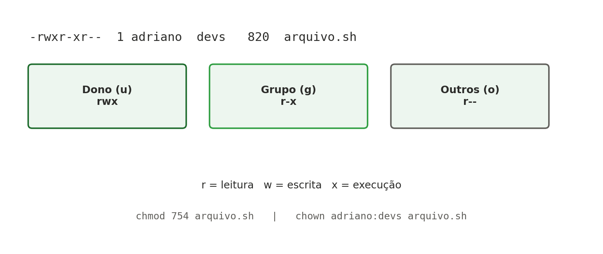

[← Anterior: Complemento: Acesso SSH, rede básica e teste de conectividade](02-complemento-ssh-e-rede.md) | [Índice](../../README.md) | [Próximo: Semana 4: Armazenamento e monitoramento básico →](04-semana04-armazenamento.md)

# Semana 3 — Permissões e sistema de arquivos

## Teoria

No Linux, cada arquivo tem um dono (**user**), um grupo (**group**) e permissões para "outros" (**others**). Cada uma dessas categorias pode ter permissão de leitura (**r**), escrita (**w**) e execução (**x**).



As permissões também podem ser representadas em formato octal:

| Permissão | Valor |
|---|---|
| `r` (leitura) | 4 |
| `w` (escrita) | 2 |
| `x` (execução) | 1 |

Assim, `rwx` = 4+2+1 = **7**, `r-x` = 4+1 = **5**, `r--` = 4.

Além das permissões básicas, o comando **`chown`** permite alterar o dono e/ou o grupo de um arquivo — essencial para organizar o acesso quando diferentes usuários ou grupos precisam interagir com os mesmos arquivos.

## Comandos essenciais

```bash
# Ver permissões detalhadas
ls -la

# Criar um arquivo de teste
touch arquivo.sh

# Alterar dono e grupo
sudo chown adriano:devs arquivo.sh

# Alterar permissões (modo octal)
chmod 754 arquivo.sh

# Alterar permissões (modo simbólico)
chmod u+x arquivo.sh
chmod g-w arquivo.sh

# Criar usuários e grupos
sudo useradd -m aluno1
sudo groupadd devs
sudo usermod -aG devs aluno1

# Ver todos os grupos existentes no sistema e seus membros
sudo cat /etc/group

# Trocar apenas o dono de um arquivo, mantendo o grupo
sudo chown aluno1 arquivo.sh

# Trocar apenas o grupo de um arquivo
sudo chown :devs arquivo.sh
```

## Exercícios

1. Crie uma pasta `/home/compartilhada`, com um grupo `devs`, e configure permissões para que apenas o grupo tenha acesso de escrita.
2. Crie dois usuários de teste e use `chown` para transferir a posse de um arquivo de um usuário para o outro.
3. Explique (por escrito, num arquivo `respostas.md`) a diferença entre `chmod 700` e `chmod 750` em um script.
4. Desafio: usando `find`, liste todos os arquivos do seu `$HOME` com permissão de escrita para "outros" (`o+w`) — um risco comum de segurança.

---

[← Anterior: Complemento: Acesso SSH, rede básica e teste de conectividade](02-complemento-ssh-e-rede.md) | [Índice](../../README.md) | [Próximo: Semana 4: Armazenamento e monitoramento básico →](04-semana04-armazenamento.md)
