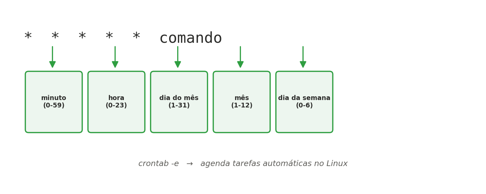

[← Anterior: Semana 4: Armazenamento e monitoramento básico](04-semana04-armazenamento.md) | [Índice](../../README.md) | [Próximo: Semana 6: Introdução a servidores web →](06-semana06-servidores-web.md)

# Semana 5 — Shell scripting para automação

## Teoria

Shell scripts automatizam tarefas repetitivas de administração. Combinados ao **cron**, permitem agendar execuções automáticas em horários específicos.



Estrutura básica de um script:

```bash
#!/bin/bash
# comentário explicando o script

VARIAVEL="valor"

if [ condição ]; then
    comando
fi

for item in lista; do
    comando "$item"
done

for item in arquivo1.txt arquivo2.txt arquivo3.txt; do
    cat "$item"
done
```

### Criando variáveis de usuário

Além das variáveis de ambiente (vistas mais adiante nesta semana), você pode criar suas próprias variáveis dentro de um script — chamadas de **variáveis de usuário**. Elas guardam valores temporários usados apenas ali, como um número, um texto ou o resultado de um comando:

```bash
#!/bin/bash
# Teste de variáveis
idade=25
nome="Monica"
echo "A $nome tem $idade anos de idade"
```

Algumas regras importantes:
- **Sem espaços ao redor do `=`**: `idade=25` funciona, mas `idade = 25` dá erro (o Bash interpretaria `idade` como um comando).
- **Aspas em textos com espaço**: `nome="Monica Silva"` precisa de aspas; um valor sem espaços, como `idade=25`, não exige.
- **Para usar o valor de uma variável, sempre com `$` antes do nome**: `$nome`, `$idade` — a variável sem o `$` (`nome`, `idade`) se refere ao nome dela, não ao valor.
- Diferente das variáveis de ambiente, essas variáveis de usuário só existem dentro do próprio script (ou do shell onde foram criadas) — não são repassadas a outros programas, a menos que sejam explicitamente exportadas com `export`.

### Arquivo de script

A primeira linha de um script — `#!/bin/bash` — é chamada de **shebang**. Ela indica ao sistema qual interpretador deve ser usado para executar aquele arquivo (nesse caso, o Bash). É por causa dela que você consegue rodar `./script.sh` diretamente, sem precisar digitar `bash script.sh` toda vez.

Depois de especificar o shell na primeira linha, o restante do arquivo é composto pelos comandos a serem executados, junto com os comentários necessários (qualquer linha iniciada por `#`, exceto a própria shebang, é ignorada pelo interpretador):

```bash
#!/bin/bash
# Este é meu primeiro script do bash
cd /
ls -l
```

Salve esse conteúdo como `primeiro_script.sh`, dê permissão de execução e rode:

```bash
chmod +x primeiro_script.sh
./primeiro_script.sh
```

**Por que a permissão de execução é necessária:** ter a shebang correta não é suficiente para rodar o script com `./nome_do_script.sh` — o arquivo também precisa ter a permissão de **execução (x)** ativada (lembrando da Semana 3), já que, para o Linux, um script é só um arquivo de texto como outro qualquer até que essa permissão seja concedida. Sem ela, tentar rodar `./script.sh` resulta em erro de "Permission denied":

```bash
# Ver se o script já tem permissão de execução
ls -l script.sh
# Se aparecer algo como -rw-r--r--, falta o "x" — sem permissão de execução

# Conceder permissão de execução
chmod +x script.sh

# Agora sim, o script pode ser executado diretamente
ls -l script.sh
# Deve aparecer -rwxr-xr-x (ou similar, com o "x" presente)
./script.sh
```

> Alternativa sem dar permissão de execução: é possível rodar o script chamando o interpretador diretamente, sem depender do `x` nem da shebang — `bash script.sh` ou `sh script.sh`. Mas o modo `./script.sh` é o mais usado no dia a dia, e por isso exige essa permissão.

## Comandos e exemplos

```bash
# Tornar um script executável
chmod +x script.sh
./script.sh
```

### Argumentos de linha de comando

Todo script pode receber informações de fora, passadas na hora de chamá-lo:

```bash
#!/bin/bash
echo "Nome do script: $0"
echo "Primeiro argumento: $1"
echo "Segundo argumento: $2"
echo "Todos os argumentos: $@"
echo "Quantidade de argumentos: $#"
```

Rodando `./script.sh servidor1 producao`, o resultado seria:
```
Nome do script: ./script.sh
Primeiro argumento: servidor1
Segundo argumento: producao
Todos os argumentos: servidor1 producao
Quantidade de argumentos: 2
```

- `$0` — o nome do próprio script.
- `$1`, `$2`, ... — os argumentos individuais, na ordem em que foram passados.
- `$@` — todos os argumentos, como uma lista.
- `$#` — quantos argumentos foram passados (útil para validar se o script recebeu o que precisava antes de continuar).

### Variáveis de ambiente

Uma variável comum (`VARIAVEL="valor"`) só existe dentro do shell ou script onde foi criada. Já uma **variável de ambiente** funciona como uma "variável global": fica disponível para todos os subprocessos daquele shell, incluindo outros programas e scripts que ele venha a chamar.

Alguns exemplos de variáveis de ambiente já existentes no sistema:

| Variável | O que é |
|---|---|
| `PATH` | Lista de diretórios onde o shell procura por programas executáveis |
| `USERNAME` | Nome do usuário logado |
| `TERM` | Tipo de terminal ou janela de terminal em uso |
| `HOME` | Diretório home do usuário atual |
| `UID` | UID (identificador numérico) do usuário atual |
| `RANDOM` | Gera um número aleatório a cada vez que é lida |
| `LANG` | Idioma configurado, especificado como *locale* |

```bash
# Ver o valor de uma variável de ambiente específica
echo $HOME
echo $PATH

# Listar todas as variáveis de ambiente do terminal atual
env
printenv

# Ver só uma variável específica com printenv
printenv LANG
```

**Usando variáveis de ambiente dentro de um script:** como já são conhecidas pelo shell, essas variáveis podem ser lidas diretamente em qualquer script, sem precisar declará-las antes:

```bash
#!/bin/bash
# Informações sobre o usuário:
echo "Usuário: $USER"
echo "Diretório home: $HOME"
echo "UID do usuário: $UID"
```

Rodando esse script, a saída mostra os valores já preenchidos automaticamente pelo sistema, sem que o script precise perguntar nada ao usuário — por exemplo:
```
Usuário: adriano
Diretório home: /home/adriano
UID do usuário: 1000
```

Isso é bastante útil para escrever scripts que se adaptam automaticamente a quem os executa, sem valores fixos ("hardcoded") no meio do código.

**Criando uma variável de ambiente própria:** por padrão, toda variável que você cria (`MINHA_VAR="valor"`) é local ao shell atual — se você chamar um script ou outro programa a partir dali, ele não vai enxergar essa variável. Para torná-la uma variável de ambiente (visível também pelos subprocessos), use o comando `export`:

```bash
# Cria uma variável local
AMBIENTE="producao"

# Torna essa variável visível também para subprocessos (scripts, programas chamados a partir daqui)
export AMBIENTE

# Ou nas duas linhas de uma vez
export AMBIENTE="producao"
```

Isso é bastante usado, por exemplo, para configurar variáveis que um script precisa ler (`export DB_HOST="localhost"`) sem precisar passá-las como argumento toda vez.

**Mas isso vale só para a sessão atual do terminal** — feche o terminal e a variável `export`ada desaparece. Para que uma variável de ambiente (ou qualquer configuração) esteja sempre disponível, ela precisa ser colocada em um dos **arquivos de inicialização** do shell, que o Bash lê automaticamente em momentos específicos:

| Arquivo | Uso |
|---|---|
| `/etc/profile` | Arquivo de inicialização, executado durante o login e válido para todo o sistema; contém variáveis de ambiente e programas de inicialização |
| `/etc/bashrc` ou `/etc/bash.bashrc` | Arquivo de inicialização, válido para todo o sistema, executado pelo `.bashrc` do usuário para cada shell bash iniciado. Contém funções e aliases |
| `~/.bash_profile` | Se existir, será executado após `/etc/profile` durante o login |
| `~/.bash_login` | Se o `.bash_profile` não existir, será executado automaticamente durante o login |
| `~/.profile` | Se nenhum dos dois anteriores existir, será executado automaticamente no login |
| `~/.bashrc` | Executado automaticamente quando o bash é iniciado interativamente |
| `~/.inputrc` | Contém variáveis e configurações do modo de operação do bash em relação às teclas (vinculação) |
| `~/.bash_logout` | Executado automaticamente no logout |

Na prática, o mais comum no dia a dia é editar o `~/.bashrc` (para configurações do próprio usuário, que valem em qualquer shell interativo que ele abrir) ou o `/etc/profile` (quando a configuração deve valer para todos os usuários do sistema):

```bash
# Editar o .bashrc do usuário atual
nano ~/.bashrc

# Adicione ao final do arquivo, por exemplo:
export EDITOR=nano
export DB_HOST=localhost

# Aplique sem precisar abrir um novo terminal
source ~/.bashrc
```

> O comando `source` (ou o atalho `.`) executa o conteúdo de um arquivo no shell atual, sem precisar abrir uma nova sessão — é assim que se testa uma alteração no `.bashrc` imediatamente.

### Operadores de comparação

Dentro de um `if`, o tipo de comparação muda dependendo se você está comparando números ou textos:

```bash
# Comparação numérica
if [ "$IDADE" -eq 18 ]; then echo "tem exatamente 18"; fi
if [ "$IDADE" -gt 18 ]; then echo "maior que 18"; fi
if [ "$IDADE" -lt 18 ]; then echo "menor que 18"; fi

# Comparação de texto (string)
if [ "$AMBIENTE" = "producao" ]; then echo "é produção"; fi
if [ "$AMBIENTE" != "producao" ]; then echo "não é produção"; fi
```

| Numérico | Significado | String | Significado |
|---|---|---|---|
| `-eq` | igual | `=` | igual |
| `-ne` | diferente | `!=` | diferente |
| `-gt` | maior que | | |
| `-lt` | menor que | | |
| `-ge` | maior ou igual | | |
| `-le` | menor ou igual | | |

**`[ ]` vs `[[ ]]`**: `[ ]` é a sintaxe mais antiga e portátil (funciona em qualquer shell POSIX), mas é mais rígida — exige aspas cuidadosas em torno de variáveis para não quebrar com espaços ou strings vazias. `[[ ]]` é uma extensão do Bash, mais segura e flexível: permite operadores como `&&`/`||` diretamente dentro dos colchetes, comparação de padrões (`[[ $ARQUIVO == *.log ]]`) e é mais tolerante a variáveis vazias ou com espaços. Na prática, em scripts que só vão rodar em Bash (a maioria dos casos em servidores Linux modernos), prefira `[[ ]]`.

### Decisão condicional: If-Then-Else

A estrutura condicional completa do Bash segue este formato geral:

```bash
if comando
then
    comandos
else
    outros comandos
fi
```

O **condicional composto** (`if...then...else...fi`) permite executar um bloco de código caso o comando testado retorne código de status zero (sucesso), e outro bloco de código caso retorne status diferente de zero (erro). O `else` é opcional — quando omitido, se o comando falhar, o `if` simplesmente não executa nada e segue para a linha depois do `fi`.

### If-Then: testando o resultado de um comando diretamente

Todos os exemplos acima usam `[ ]` ou `[[ ]]` para testar uma condição. Mas o `if` não exige isso — ele pode testar **qualquer comando**, usando diretamente o código de saída dele (o `$?` visto na seção de exit codes): se o comando terminar com `0` (sucesso), o `if` é considerado verdadeiro; qualquer outro valor é considerado falso.

```bash
#!/bin/bash
# Exemplo de condicional simples em um script
if cd /
then
    echo "Diretório raiz encontrado!"
fi
```

Aqui, `cd /` é o próprio teste: se o comando `cd /` conseguir executar (o diretório existe e há permissão de acesso), ele retorna `0` e o bloco `then` roda. Se `cd /` falhar por algum motivo, o `if` é considerado falso e o `echo` não é executado — sem precisar de nenhum `[ ]` ou comparação explícita.

Esse padrão é muito comum na prática, por exemplo para verificar se um comando foi bem-sucedido antes de continuar:

```bash
if ping -c 1 google.com &> /dev/null
then
    echo "Internet disponível"
else
    echo "Sem conexão"
fi
```

> Repare que isso é exatamente o mesmo mecanismo por trás do `&&` e `||` vistos em "Execução condicional em pipeline" — o `if` só está tornando essa lógica mais legível quando há vários comandos ou um bloco maior de código a executar.

### Códigos de saída (exit codes)

Todo comando ou script, ao terminar, retorna um **código de saída**: `0` significa sucesso, qualquer valor de `1` a `255` significa algum tipo de erro (o número específico geralmente indica o motivo).

```bash
# Ver o código de saída do último comando executado
ls /pasta/que/nao/existe
echo $?    # deve mostrar um valor diferente de 0

# Forçar um código de saída específico no fim de um script
if [ ! -d "/mnt/dados" ]; then
    echo "Erro: diretório não encontrado" >&2
    exit 1
fi

echo "Tudo certo"
exit 0
```

**Status de saída: alguns significados**

Embora um script possa definir livremente seus próprios códigos (como o `exit 1` do exemplo acima), alguns valores têm um significado padronizado no Linux, gerado automaticamente pelo próprio shell em certas situações:

| Código | Significado |
|---|---|
| `0` | Comando completado com sucesso |
| `1` | Erro geral desconhecido |
| `126` | O comando não pode ser executado (permissões) |
| `127` | Comando não encontrado |
| `130` | Comando finalizado com Ctrl + C |

Para ver o código de status de um comando, digite `echo $?` logo após o término de sua execução:

```bash
# Exemplo do código 127 — comando que não existe
comando_inexistente
echo $?
# 127

# Exemplo do código 126 — script sem permissão de execução
./script_sem_permissao.sh
echo $?
# 126
```

Isso importa porque outros programas — inclusive o próprio cron, ou uma pipeline de CI/CD que veremos na Unidade 2 — decidem o que fazer a seguir com base nesse código. Um script que sempre retorna `0`, mesmo quando algo deu errado internamente, engana quem depende dele: um alerta que deveria disparar não dispara, uma pipeline que deveria parar continua. Todo script bem escrito deve refletir corretamente, no seu código de saída, se a tarefa foi concluída com sucesso ou não.

### Manipulação de texto

Ferramentas clássicas de linha de comando para filtrar e transformar texto — extremamente úteis para analisar logs e saídas de outros comandos:

```bash
# grep — buscar linhas que casam com um padrão
grep "error" /var/log/syslog
grep -i "error" /var/log/syslog        # ignora maiúsculas/minúsculas
grep -c "error" /var/log/syslog        # conta quantas ocorrências

# grep -E — expressões regulares estendidas
grep -E "error|fail|critical" /var/log/syslog
grep -E "^[0-9]{3}" acessos.log        # linhas que começam com 3 dígitos

# sed — substituir texto
sed 's/error/ERRO/g' arquivo.log       # troca todas as ocorrências
sed -i 's/producao/homologacao/g' config.txt   # edita o arquivo diretamente (-i)

# awk — processar texto por colunas
awk '{print $1}' acessos.log           # imprime só a primeira coluna
awk -F, '{print $2}' dados.csv         # usa vírgula como separador de coluna

# cut — extrair pedaços de cada linha
cut -d: -f1 /etc/passwd                # extrai o 1º campo, separado por ":"

# sort e uniq — ordenar e remover duplicatas
sort nomes.txt
sort nomes.txt | uniq                  # remove linhas duplicadas adjacentes
sort nomes.txt | uniq -c               # conta quantas vezes cada linha aparece
```

Essas ferramentas são frequentemente combinadas em **pipeline** (usando `|`) para compor análises mais complexas — por exemplo, listar os 5 IPs que mais acessaram um servidor:

```bash
awk '{print $1}' acesso.log | sort | uniq -c | sort -rn | head -5
```

### Here-documents

Um **here-document** (`<<EOF ... EOF`) permite gerar um bloco de texto (ou um arquivo inteiro) diretamente de dentro de um script, sem precisar de vários `echo` separados — muito usado para gerar arquivos de configuração:

```bash
#!/bin/bash
cat <<EOF > /etc/nginx/sites-available/meusite
server {
    listen 80;
    server_name $DOMINIO;
    root /var/www/meusite;
}
EOF

echo "Configuração criada para $DOMINIO"
```

Repare que variáveis como `$DOMINIO` são expandidas normalmente dentro do bloco — o que torna possível gerar configurações dinâmicas a partir de um template.

### Execução condicional em pipeline

Além do `if`, é comum encadear comandos diretamente na linha, decidindo o que roda a seguir com base no sucesso ou falha do comando anterior:

```bash
# && — só executa o próximo comando se o anterior teve sucesso (exit code 0)
mkdir /mnt/backup && echo "Pasta criada com sucesso"

# || — só executa o próximo comando se o anterior FALHOU
ping -c 1 servidor.com || echo "Servidor não respondeu"

# ; — executa os comandos em sequência, independente do resultado do anterior
cd /tmp; ls; pwd
```

Isso é uma forma compacta de tratamento de erro, muito usada em scripts curtos e em pipelines de CI/CD:

```bash
sudo systemctl restart nginx && echo "Nginx reiniciado" || echo "Falha ao reiniciar o Nginx"
```

### Formatação do comando `date`

O comando `date` exibe a data e hora atuais, mas o mais útil em scripts é poder **formatá-lo** — por exemplo, para nomear arquivos de backup ou registrar quando algo aconteceu em um log. Isso é feito com `date +FORMATO`, usando códigos precedidos de `%`:

| Código | Significado | Exemplo |
|---|---|---|
| `%Y` | Ano com 4 dígitos | 2026 |
| `%y` | Ano com 2 dígitos | 26 |
| `%m` | Mês (01-12) | 08 |
| `%d` | Dia do mês (01-31) | 27 |
| `%H` | Hora (00-23) | 14 |
| `%M` | Minuto (00-59) | 30 |
| `%S` | Segundo (00-59) | 05 |

Esses códigos são combinados livremente para montar o formato que você quiser:

```bash
# Data no formato ano-mês-dia
date +%Y-%m-%d
# 2026-08-27

# Data e hora, separadas por underline (bom para nomes de arquivo)
date +%Y-%m-%d_%H-%M-%S
# 2026-08-27_14-30-05

# Só a hora, no formato hora:minuto
date +%H:%M
# 14:30
```

> Repare que não pode haver espaço entre o `+` e o formato, nem dentro do formato (se precisar de um espaço no resultado, use aspas: `date "+%Y-%m-%d %H:%M"`).

Isso é exatamente o que torna possível nomear cada backup com um "timestamp" único, como no exemplo a seguir:

Exemplo — script de backup simples (`backup.sh`):

```bash
#!/bin/bash
DATA=$(date +%Y-%m-%d_%H-%M)
ORIGEM="/home/adriano/dados"
DESTINO="/home/adriano/backups/backup_$DATA.tar.gz"

tar -czf "$DESTINO" "$ORIGEM"
echo "Backup criado em $DESTINO"
```

Agendando com cron:

```bash
crontab -e
```

Adicione a linha (executa todo dia às 2h da manhã):

```
0 2 * * * /home/adriano/backup.sh >> /home/adriano/backup.log 2>&1
```

### Mais exemplos de scripts

**Exemplo — verificando se um serviço está no ar (`checar_servico.sh`):**

```bash
#!/bin/bash
# Verifica se um serviço systemd está ativo; caso não esteja, tenta reiniciar

SERVICO="$1"

if [ "$#" -eq 0 ]; then
    echo "Uso: ./checar_servico.sh <nome-do-servico>"
    exit 1
fi

if systemctl is-active --quiet "$SERVICO"; then
    echo "$SERVICO está rodando normalmente."
    exit 0
else
    echo "$SERVICO está parado. Tentando reiniciar..."
    sudo systemctl restart "$SERVICO"
    exit $?
fi
```

**Exemplo — criando múltiplos usuários a partir de uma lista (`criar_usuarios.sh`):**

```bash
#!/bin/bash
# Lê uma lista de nomes de um arquivo e cria um usuário para cada um

ARQUIVO="$1"

if [ ! -f "$ARQUIVO" ]; then
    echo "Arquivo $ARQUIVO não encontrado."
    exit 1
fi

while read -r NOME; do
    if id "$NOME" &>/dev/null; then
        echo "Usuário $NOME já existe, pulando."
    else
        sudo useradd -m "$NOME"
        echo "Usuário $NOME criado."
    fi
done < "$ARQUIVO"
```

**Exemplo — monitor simples de espaço em disco com alerta (`monitor_disco.sh`):**

```bash
#!/bin/bash
# Verifica o uso do disco raiz e alerta se ultrapassar o limite definido

LIMITE=80
USO=$(df / | tail -1 | awk '{print $5}' | tr -d '%')

if [ "$USO" -ge "$LIMITE" ]; then
    echo "$(date): ALERTA - uso de disco em ${USO}%, acima do limite de ${LIMITE}%." >> /var/log/monitor_disco.log
    exit 1
else
    echo "$(date): uso de disco em ${USO}%, dentro do normal." >> /var/log/monitor_disco.log
    exit 0
fi
```

> Lembre-se: assim como no `primeiro_script.sh`, todos esses exemplos precisam de `chmod +x` antes de poderem ser rodados com `./nome_do_script.sh` — por exemplo, `chmod +x monitor_disco.sh`.

## Exercícios

1. Escreva um script que verifique o uso de disco (`df -h`) e envie um alerta (`echo` em um arquivo de log) se o uso passar de 80%. Faça o script terminar com `exit 1` se disparou o alerta, e `exit 0` caso contrário.
2. Agende esse script para rodar a cada 15 minutos usando cron.
3. Escreva um script que receba um nome de pasta como argumento (`$1`) e conte quantos arquivos existem dentro dela. Se nenhum argumento for passado (`$#` igual a 0), o script deve exibir uma mensagem de uso e sair com `exit 1`.
4. Use `grep -E`, `awk` e `sort`/`uniq` para encontrar, num arquivo de log, quais são as 3 mensagens de erro mais frequentes.
5. Desafio: crie um script que rotacione logs — renomeie `app.log` para `app.log.antigo` e crie um `app.log` vazio, apenas se o arquivo atual passar de 1MB. Use um here-document para registrar, num arquivo de relatório, a data e o motivo da rotação.

---

[← Anterior: Semana 4: Armazenamento e monitoramento básico](04-semana04-armazenamento.md) | [Índice](../../README.md) | [Próximo: Semana 6: Introdução a servidores web →](06-semana06-servidores-web.md)
