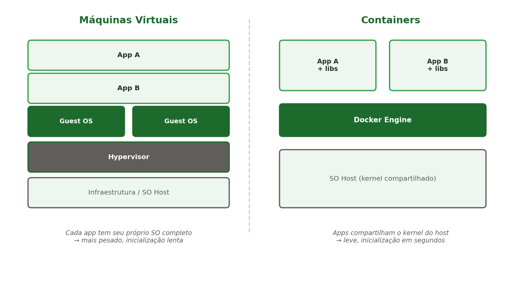
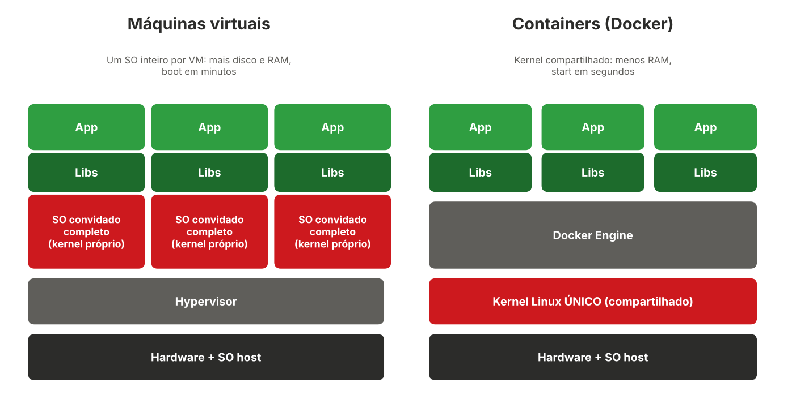
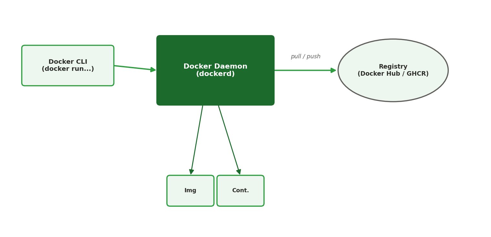

[← Anterior: Preparando o Docker no WSL2](00-preparando-docker.md) | [Índice](../../README.md) | [Próximo: Semana 11: Docker avançado →](11-semana11-docker-avancado.md)

# Semana 10 — Introdução a containers e Docker

## Teoria

Um **container** empacota uma aplicação junto com tudo que ela precisa para rodar (código, dependências, bibliotecas), de forma isolada, leve e portátil. Diferente de uma máquina virtual, que virtualiza um computador inteiro (incluindo um sistema operacional completo), o container compartilha o kernel do sistema operacional host, o que o torna muito mais leve e rápido de iniciar.



### Comparando o consumo de memória

Cada máquina virtual precisa de um sistema operacional convidado completo: kernel, serviços de sistema, bibliotecas e memória reservada para tudo isso, mesmo que a aplicação em si seja pequena. Com 10 VMs, existem 10 kernels rodando e 10 sistemas operacionais consumindo RAM e disco.

Um container carrega apenas a aplicação e suas bibliotecas. Com 10 containers, existe **um único kernel** (o do host) e 10 processos isolados. Na prática:

| Característica | Máquina virtual | Container |
|---|---|---|
| O que carrega | SO completo + app | App + bibliotecas |
| Tamanho típico em disco | Gigabytes | Dezenas a centenas de megabytes |
| Memória só para o SO | Centenas de MB por instância | Praticamente nenhuma extra |
| Tempo de inicialização | Segundos a minutos | Frações de segundo a poucos segundos |
| Densidade por máquina | Poucas dezenas | Centenas |
| Isolamento | Forte (kernel próprio) | Menor (kernel compartilhado) |

Os números variam muito conforme a imagem e a aplicação, por isso a tabela mostra ordens de grandeza. Você vai medir isso na prática no exercício 5.

### Como o kernel é compartilhado



Um container **não é uma mini VM**. Ele é um processo comum do Linux, com duas proteções fornecidas pelo próprio kernel:

- **Namespaces** definem o que o processo enxerga: seus próprios PIDs, rede, pontos de montagem, hostname e usuários. Dentro do container, o seu processo parece ser o PID 1 de uma máquina isolada.
- **cgroups** (control groups) definem quanto o processo pode usar: limites de CPU, memória e I/O. É o que permite, por exemplo, `docker run --memory=256m`.
- **Sistema de arquivos em camadas** (overlay): as imagens são compostas de camadas somente leitura que podem ser reaproveitadas por vários containers. Dez containers do mesmo `nginx` compartilham as mesmas camadas em disco e só gravam as diferenças.

Consequências importantes:

1. O container usa o kernel do host. Por isso, containers Linux só rodam sobre um kernel Linux. No **WSL2**, eles usam o kernel Linux do próprio WSL2. No Docker Desktop para Windows ou macOS existe uma VM Linux leve por baixo.
2. Você pode conferir isso: `uname -r` dentro de um container mostra a mesma versão de kernel do host.
3. Como o kernel é compartilhado, uma falha de segurança no kernel pode afetar todos os containers. Por isso o isolamento é considerado menor que o de uma VM, e boas práticas importam (não rodar como root, não usar `--privileged` sem necessidade, manter imagens atualizadas).

### Vantagens do Docker

- **Leveza:** menos RAM e disco por aplicação, mais serviços na mesma máquina.
- **Inicialização rápida:** subir ou reiniciar um serviço leva segundos.
- **Portabilidade:** "funciona na minha máquina" passa a valer em qualquer lugar com Docker (notebook, servidor, nuvem).
- **Reprodutibilidade:** o `Dockerfile` descreve o ambiente como código, e qualquer pessoa chega ao mesmo resultado.
- **Isolamento de dependências:** cada aplicação traz suas versões de Python, Node ou bibliotecas, sem conflitos.
- **Imagens versionadas:** tags permitem voltar para uma versão anterior (rollback) com um comando.
- **Encaixe com CI/CD:** a mesma imagem testada no pipeline é a que vai para produção.
- **Base para microsserviços e orquestração:** facilita dividir sistemas e escalar (Compose, Kubernetes).
- **Ecossistema:** milhares de imagens prontas no Docker Hub (bancos, servidores web, linguagens).

### Opções de uso do Docker e do ecossistema

| Opção | Para que serve |
|---|---|
| **Docker Engine** (Linux e WSL2) | Uso direto pela linha de comando, é o que usamos na disciplina |
| **Docker Desktop** (Windows, macOS, Linux) | Interface gráfica, integração com WSL2, Compose e Kubernetes local |
| **Podman, containerd e outros runtimes** | Alternativas compatíveis com imagens OCI, o Podman funciona sem daemon |
| **Docker Compose** | Subir várias partes de uma aplicação (app, banco, proxy) em uma máquina |
| **Kubernetes** | Orquestrar containers em vários servidores (ver material complementar) |
| **Serviços de nuvem** | AWS ECS e Fargate, Google Cloud Run, Azure Container Apps |
| **Dev Containers** | Ambiente de desenvolvimento padronizado dentro do VS Code |
| **CI/CD** | Runners e jobs que executam em containers (GitHub Actions, GitLab CI) |
| **Bancos e ferramentas locais** | Subir PostgreSQL, Redis ou RabbitMQ em segundos, sem instalar nada no sistema |

### Quanto o Docker é usado hoje

Alguns dados de pesquisas recentes (valores arredondados, consulte as fontes):

- **Stack Overflow Developer Survey 2025:** o Docker é usado por cerca de **71%** dos respondentes e por cerca de **74%** dos desenvolvedores profissionais, a ferramenta com maior crescimento do ano (cerca de 17 pontos percentuais, em parte por mudança de categorias na pesquisa). Entre as tecnologias de containers e orquestração, o Kubernetes aparece com cerca de 28% e o Podman com cerca de 11%.
- **Relatório State of Application Development 2025 (Docker Inc.):** cerca de **92%** dos profissionais de TI ouvidos dizem usar containers (eram cerca de 80% no ano anterior), e cerca de 30% nos demais setores.

Lembre-se de que o segundo relatório foi publicado pela própria empresa Docker, com amostra de pouco mais de 4.500 pessoas, então pode ter viés. Mesmo assim, as duas fontes apontam na mesma direção: containers viraram padrão no desenvolvimento e na operação de software. As fontes completas estão em [Referências](../referencias.md).

O **Docker** é a ferramenta mais usada para criar, rodar e gerenciar containers. Sua arquitetura básica:



- **Docker CLI** — a ferramenta de linha de comando (`docker ...`) que você usa para dar comandos.
- **Docker Daemon (`dockerd`)** — o processo que realmente gerencia containers, imagens, redes e volumes em segundo plano.
- **Imagem** — um "molde" somente leitura, com tudo que a aplicação precisa (sistema de arquivos, dependências, comando de inicialização).
- **Container** — uma instância em execução de uma imagem.
- **Registry** — um repositório de imagens (ex.: Docker Hub, GitHub Container Registry), de onde imagens são baixadas (`pull`) ou enviadas (`push`).

## Comandos essenciais

```bash
# Baixar uma imagem do Docker Hub
docker pull nginx

# Listar imagens baixadas localmente
docker images

# Rodar um container a partir de uma imagem
docker run nginx

# Rodar em segundo plano (-d) e mapear a porta 8080 do host para a 80 do container
docker run -d -p 8080:80 --name meu-nginx nginx

# Entrar no terminal de um container em execução
docker exec -it meu-nginx bash

# Listar containers em execução
docker ps

# Listar todos os containers (inclusive parados)
docker ps -a

# Ver logs de um container
docker logs meu-nginx

# Parar e remover um container
docker stop meu-nginx
docker rm meu-nginx
```

Acesse `http://localhost:8080` no navegador do Windows — deve aparecer a página padrão do Nginx, agora rodando dentro de um container.

## Criando sua primeira imagem (Dockerfile)

Um `Dockerfile` descreve, passo a passo, como construir uma imagem. Vamos containerizar a mesma aplicação simples usada na Unidade 1.

**Antes, crie uma pasta própria para o exemplo.** O `docker build` usa a pasta atual como *contexto de build* e o `COPY . .` copia tudo que está nela para dentro da imagem. Por isso, não rode o build na sua pasta pessoal nem em uma pasta com muitos arquivos.

```bash
# Criar e entrar na pasta do exemplo (dentro do Linux, não em /mnt/c)
mkdir ~/minha-app
cd ~/minha-app

# Criar uma página simples para o servidor mostrar
echo "<h1>Olá de dentro do container</h1>" > index.html

# Criar o Dockerfile nesta pasta (cole o conteúdo abaixo, salve com Ctrl+O e saia com Ctrl+X)
nano Dockerfile
```

> **Dica WSL2:** crie a pasta dentro do sistema de arquivos do Linux (por exemplo `~/minha-app`). Pastas do Windows acessadas por `/mnt/c/...` são bem mais lentas para o Docker.

Conteúdo do `Dockerfile`:

```dockerfile
FROM python:3.12-slim

WORKDIR /app

COPY . .

EXPOSE 8000

CMD ["python3", "-m", "http.server", "8000"]
```

- **`FROM`** — a imagem-base sobre a qual a sua é construída (aqui, Python já instalado).
- **`WORKDIR`** — define o diretório de trabalho dentro do container.
- **`COPY`** — copia arquivos do seu computador para dentro da imagem.
- **`EXPOSE`** — documenta qual porta a aplicação usa (não publica a porta sozinho — isso é feito no `docker run -p`).
- **`CMD`** — o comando executado quando o container inicia.

Com a pasta `~/minha-app` contendo `index.html` e `Dockerfile`, construa e rode:

```bash
# Construir a imagem a partir do Dockerfile na pasta atual
docker build -t minha-app:1.0 .

# Rodar a imagem construída
docker run -d -p 8000:8000 --name minha-app minha-app:1.0

# Testar
curl http://localhost:8000
```

## Ciclo de vida de um container

Um container passa por estados bem definidos, e cada comando do Docker move o container de um estado para outro:

| Estado | Significado | Como chegar |
|---|---|---|
| **Created** | Foi criado, mas ainda não iniciou | `docker create` (ou falha ao iniciar no `docker run`) |
| **Running** | Em execução | `docker start`, `docker run` |
| **Paused** | Processos congelados | `docker pause` (volta com `docker unpause`) |
| **Exited** | Terminou ou foi parado, mas ainda existe | `docker stop`, ou o processo principal acabou |
| **Removido** | Não existe mais | `docker rm` |

Um container vive enquanto o seu **processo principal** (o `CMD`) estiver rodando. Se esse processo termina, o container passa para `Exited`. Por isso uma imagem como `ubuntu`, que por padrão só abre um shell, sai imediatamente quando rodada com `-d`.

```bash
# Criar sem iniciar, depois iniciar
docker create --name teste nginx
docker start teste

# Parar de forma educada (SIGTERM, depois SIGKILL após 10s) e reiniciar
docker stop teste
docker restart teste

# Matar na hora (SIGKILL), parecido com o kill -9 da Semana 2
docker kill teste

# Remover um container parado, ou forçar a remoção de um em execução
docker rm teste
docker rm -f teste
```

Você já viu os sinais `SIGTERM` e `SIGKILL` na Semana 2. O `docker stop` envia o primeiro e, se o processo não encerrar, o segundo.

## Opções importantes do docker run

```bash
# Container temporário: é removido automaticamente quando termina
docker run --rm hello-world

# Modo interativo com terminal (-it), útil para explorar uma imagem
docker run -it --rm ubuntu bash

# Passar variáveis de ambiente para a aplicação
docker run -d -e MENSAGEM="Olá turma" --name app-env minha-app:1.0

# Limitar memória e CPU (usa os cgroups explicados na teoria)
docker run -d --memory=256m --cpus=0.5 --name limitado nginx

# Política de reinício: volta sozinho se cair ou se o Docker reiniciar
docker run -d --restart unless-stopped --name sempre-no-ar nginx
```

Dentro do `docker run -it --rm ubuntu bash`, rode `cat /etc/os-release` e `ps aux`. Você vai ver uma distribuição diferente do seu WSL2 e uma lista de processos quase vazia, o que mostra o isolamento por namespaces.

## Inspecionando e depurando containers

```bash
# Consumo de CPU e memória em tempo real (parecido com o top)
docker stats

# Processos rodando dentro de um container
docker top meu-nginx

# Detalhes completos em JSON (IP, volumes, variáveis, portas)
docker inspect meu-nginx

# Só o IP do container, usando um filtro de formato
docker inspect -f '{{ .NetworkSettings.IPAddress }}' meu-nginx

# Acompanhar logs em tempo real, mostrando as últimas 20 linhas
docker logs -f --tail 20 meu-nginx

# Copiar arquivos entre o seu computador e o container
docker cp index.html meu-nginx:/usr/share/nginx/html/index.html
docker cp meu-nginx:/etc/nginx/nginx.conf ./nginx.conf
```

Experimente o `docker cp` com a página `index.html` da Semana 6: copie para dentro do container do Nginx e atualize o navegador em `http://localhost:8080`.

> Alterações feitas dentro de um container em execução (com `docker exec` ou `docker cp`) **somem quando ele é removido**. Para algo permanente, a mudança deve entrar na imagem (Dockerfile) ou em um volume (Semana 11).

## Entendendo imagens: camadas, tags e Docker Hub

Uma imagem é formada por **camadas** empilhadas, e cada instrução do Dockerfile (`FROM`, `COPY`, `RUN`) gera uma camada. Camadas iguais são reaproveitadas entre imagens e armazenadas só uma vez, o que economiza disco e acelera downloads.

```bash
# Ver as camadas de uma imagem e o tamanho de cada uma
docker history minha-app:1.0

# Ver detalhes da imagem
docker image inspect minha-app:1.0
```

O nome completo de uma imagem segue o formato `repositório:tag`, por exemplo `python:3.12-slim`. A **tag** identifica a versão. Se você não informa a tag, o Docker usa `latest`, que é só um nome e **não garante** que seja a versão mais nova. Em projetos reais, fixe sempre uma versão (como `nginx:1.27`) para o build ser reproduzível.

```bash
# Dar um novo nome (tag) a uma imagem existente
docker tag minha-app:1.0 minha-app:estavel

# Publicar no Docker Hub (precisa de conta gratuita em hub.docker.com)
docker login
docker tag minha-app:1.0 SEU_USUARIO/minha-app:1.0
docker push SEU_USUARIO/minha-app:1.0

# Qualquer pessoa (ou servidor) agora pode baixar
docker pull SEU_USUARIO/minha-app:1.0
```

Na Unidade 2 você vai usar o mesmo fluxo com o **GitHub Container Registry** (GHCR), dentro do pipeline de CI/CD.

## Limpeza do ambiente

Com o tempo, containers parados e imagens antigas ocupam bastante disco, principalmente no WSL2.

```bash
# Ver quanto espaço o Docker está usando
docker system df

# Remover containers parados
docker container prune

# Remover imagens sem uso (as "dangling")
docker image prune

# Limpeza geral: containers parados, redes sem uso e imagens sem uso
docker system prune
```

## Boas práticas de Dockerfile

- Prefira imagens base **`slim`** ou **`alpine`**, bem menores que as imagens completas.
- Use um arquivo **`.dockerignore`** para não copiar arquivos desnecessários (`.git`, `node_modules`, arquivos de senha) para dentro da imagem.
- Combine comandos `RUN` relacionados em uma única linha (com `&&`) para reduzir o número de camadas.
- Copie primeiro os arquivos de dependências (ex.: `package.json` ou `requirements.txt`) e só depois o restante do código. Isso aproveita o cache de camadas quando só o código muda.
- Fixe a versão da imagem base (`python:3.12-slim`, não `python:latest`).
- Não rode a aplicação como root quando possível (instrução `USER`).

Exemplo de `.dockerignore` para a pasta `~/minha-app`:

```
.git
node_modules
*.log
.env
Dockerfile
.dockerignore
```

## Solução de problemas comuns

| Mensagem ou sintoma | Causa | Solução |
|---|---|---|
| `Conflict. The container name "/minha-app" is already in use` | Já existe um container (mesmo parado) com esse nome | `docker ps -a` e depois `docker rm -f minha-app` |
| `port is already allocated` | Outro container ou programa já usa a porta do host | Troque a porta da esquerda no `-p` (ex.: `-p 8081:8000`) |
| A página não abre no navegador | Porta do container diferente da usada pela aplicação | Confira o `CMD` e use `-p PORTA_HOST:PORTA_DA_APLICACAO` |
| Container em `Exited` logo após iniciar | O processo principal terminou ou deu erro | `docker logs NOME` para ver o motivo |
| `permission denied` ao usar o Docker | Seu usuário não está no grupo `docker` | `sudo usermod -aG docker $USER` e abra um novo terminal |
| `docker rm` diz que o container não existe | Nome digitado errado | Confira o nome exato na coluna `NAMES` do `docker ps -a` |

O formato do mapeamento de portas é sempre `-p PORTA_DO_HOST:PORTA_DO_CONTAINER`.

## Exercícios

1. Baixe e rode a imagem oficial do `nginx`, mapeando para a porta 8080, e acesse pelo navegador.
2. Containerize a aplicação Python simples (ou a página estática da Semana 6) usando o `Dockerfile` acima.
3. Use `docker exec -it` para entrar no container rodando e explorar seu sistema de arquivos com `ls`.
4. Desafio: pesquise a diferença entre `docker stop` e `docker kill`, e explique quando usar cada um.
5. Meça o consumo: rode `docker run -d --name n1 nginx`, depois `n2` e `n3` (portas diferentes). Compare `docker stats --no-stream`, `free -h` antes e depois, e `docker images` (tamanho). Rode também `uname -r` no WSL2 e `docker exec n1 uname -r` e explique por que o resultado é igual.
6. Rode `docker run -it --rm ubuntu bash` e dentro dele execute `cat /etc/os-release` e `ps aux`. Compare com o seu WSL2.
7. Rode um container com `--memory=128m` e confirme o limite em `docker stats`.
8. Use `docker cp` para trocar a página padrão do Nginx pelo `index.html` da Semana 6.
9. Crie o `.dockerignore` para a pasta `~/minha-app` e rode `docker history minha-app:1.0` para ver as camadas.
10. Crie uma conta no Docker Hub, faça `docker tag` e `docker push` da sua imagem e peça para um colega fazer `docker pull`.
11. Provoque de propósito o erro de nome em uso (rode duas vezes o mesmo `docker run --name`) e resolva usando `docker ps -a` e `docker rm`.

---

[← Anterior: Preparando o Docker no WSL2](00-preparando-docker.md) | [Índice](../../README.md) | [Próximo: Semana 11: Docker avançado →](11-semana11-docker-avancado.md)
