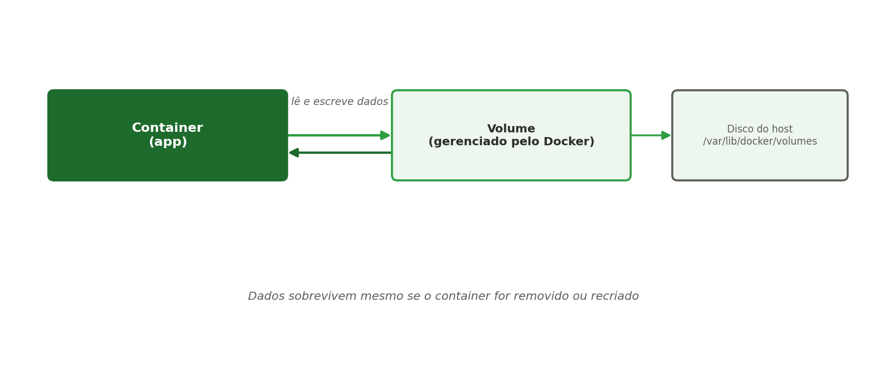

[← Anterior: Semana 10: Introdução a containers e Docker](10-semana10-introducao-docker.md) | [Índice](../../README.md) | [Próximo: Semana 12: Docker Compose →](12-semana12-docker-compose.md)

# Semana 11 — Docker avançado

## Teoria

Containers são, por natureza, **efêmeros**: ao serem removidos, tudo que foi escrito dentro deles se perde. Para dados que precisam persistir (como os de um banco de dados), o Docker oferece **volumes**:



Além disso, containers se comunicam entre si através de **redes Docker**. Esta semana também aprofunda o dia a dia com containers: inspeção e depuração, camadas e tags de imagens, Docker Hub, limpeza do ambiente e boas práticas de Dockerfile.

## Comandos essenciais — volumes

```bash
# Criar um volume nomeado
docker volume create dados_app

# Rodar um container usando esse volume
docker run -d -v dados_app:/var/lib/dados --name app-com-volume minha-app:1.0

# Listar volumes
docker volume ls

# Inspecionar onde o volume está no disco do host
docker volume inspect dados_app

# Remover um volume (o container que o usa precisa estar parado/removido)
docker volume rm dados_app
```

## Comandos essenciais — redes

```bash
# Criar uma rede customizada
docker network create minha-rede

# Rodar dois containers na mesma rede — eles conseguem se comunicar pelo nome
docker run -d --network minha-rede --name banco postgres:16
docker run -d --network minha-rede --name app minha-app:1.0

# Listar redes
docker network ls

# Inspecionar uma rede (mostra quais containers estão conectados)
docker network inspect minha-rede
```

> Dentro da rede `minha-rede`, o container `app` pode acessar o banco simplesmente usando o hostname `banco` — o Docker resolve isso internamente, sem precisar saber o IP.

## Inspecionando e depurando containers

```bash
# Consumo de CPU e memória em tempo real (parecido com o top)
docker stats

# Processos rodando dentro de um container
docker top meu-nginx

# Detalhes completos em JSON (IP, volumes, variáveis, portas)
docker inspect meu-nginx

# Só o IP do container, usando um filtro de formato
docker inspect -f '{{ .NetworkSettings.IPAddress }}' meu-nginx

# Acompanhar logs em tempo real, mostrando as últimas 20 linhas
docker logs -f --tail 20 meu-nginx

# Copiar arquivos entre o seu computador e o container
docker cp index.html meu-nginx:/usr/share/nginx/html/index.html
docker cp meu-nginx:/etc/nginx/nginx.conf ./nginx.conf
```

O formato é `docker cp ORIGEM DESTINO`. O caminho do seu computador vai sem prefixo, e o do container leva o nome na frente (`NOME:/caminho`). O caminho de destino precisa existir **no container escolhido**: a pasta `/usr/share/nginx/html` só existe em containers do Nginx, e não no container Python da aplicação (que usa `/app`).

Experimente com a página `index.html` da Semana 6, que está na sua pasta `~/minha-app`:

```bash
cd ~/minha-app
docker cp index.html meu-nginx:/usr/share/nginx/html/index.html
```

Depois atualize o navegador em `http://localhost:8080`. Para conferir o que existe dentro de um container antes de copiar, use `docker exec meu-nginx ls /usr/share/nginx/html`.

> Alterações feitas dentro de um container em execução (com `docker exec` ou `docker cp`) **somem quando ele é removido**. Para algo permanente, a mudança deve entrar na imagem (Dockerfile) ou em um volume (veja os volumes acima, nesta mesma semana).

## Entendendo imagens: camadas, tags e Docker Hub

Uma imagem é formada por **camadas** empilhadas, e cada instrução do Dockerfile (`FROM`, `COPY`, `RUN`) gera uma camada. Camadas iguais são reaproveitadas entre imagens e armazenadas só uma vez, o que economiza disco e acelera downloads.

```bash
# Ver as camadas de uma imagem e o tamanho de cada uma
docker history minha-app:1.0

# Ver detalhes da imagem
docker image inspect minha-app:1.0
```

O nome completo de uma imagem segue o formato `repositório:tag`, por exemplo `python:3.12-slim`. A **tag** identifica a versão. Se você não informa a tag, o Docker usa `latest`, que é só um nome e **não garante** que seja a versão mais nova. Em projetos reais, fixe sempre uma versão (como `nginx:1.27`) para o build ser reproduzível.

```bash
# Dar um novo nome (tag) a uma imagem existente
docker tag minha-app:1.0 minha-app:estavel

# Publicar no Docker Hub (precisa de conta gratuita em hub.docker.com)
docker login
docker tag minha-app:1.0 SEU_USUARIO/minha-app:1.0
docker push SEU_USUARIO/minha-app:1.0

# Qualquer pessoa (ou servidor) agora pode baixar
docker pull SEU_USUARIO/minha-app:1.0
```

Na Unidade 2 você vai usar o mesmo fluxo com o **GitHub Container Registry** (GHCR), dentro do pipeline de CI/CD.

## Limpeza do ambiente

Com o tempo, containers parados e imagens antigas ocupam bastante disco, principalmente no WSL2.

```bash
# Ver quanto espaço o Docker está usando
docker system df

# Remover containers parados
docker container prune

# Remover imagens "dangling" (soltas, sem nome e sem tag)
docker image prune

# Remover todas as imagens que nenhum container usa (não só as dangling)
docker image prune -a

# Limpeza geral: containers parados, redes sem uso e imagens dangling
docker system prune
```

> **O que é uma imagem *dangling*?** É uma imagem "solta", sem nome e sem tag, que aparece como `<none>:<none>` no `docker images`. Ela costuma surgir quando você reconstrói uma imagem com a mesma tag (por exemplo, `docker build -t minha-app:1.0 .` pela segunda vez): a tag passa para a imagem nova e a versão antiga fica órfã, ocupando disco. Para listar só essas imagens, use `docker images -f dangling=true`.

## Boas práticas de Dockerfile

- Prefira imagens base **`slim`** ou **`alpine`**, bem menores que as imagens completas.
- Use um arquivo **`.dockerignore`** para não copiar arquivos desnecessários (`.git`, `node_modules`, arquivos de senha) para dentro da imagem.
- Combine comandos `RUN` relacionados em uma única linha (com `&&`) para reduzir o número de camadas.
- Copie primeiro os arquivos de dependências (ex.: `package.json` ou `requirements.txt`) e só depois o restante do código. Isso aproveita o cache de camadas quando só o código muda.
- Fixe a versão da imagem base (`python:3.12-slim`, não `python:latest`).
- Não rode a aplicação como root quando possível (instrução `USER`).

Exemplo de `.dockerignore` para a pasta `~/minha-app`:

```
.git
node_modules
*.log
.env
Dockerfile
.dockerignore
```

## Prática: o que o `.dockerignore` muda na imagem

Nesta prática você vai ver um arquivo secreto "vazar" para dentro de uma imagem e depois impedir isso com o `.dockerignore`. Use a pasta `~/minha-app` criada antes, com o `Dockerfile` e o `index.html`.

**1. Crie arquivos que não deveriam entrar na imagem**

```bash
cd ~/minha-app

# Um "segredo" de mentira, como um arquivo .env de verdade teria
echo "SENHA_DO_BANCO=123456" > .env

# Um arquivo grande, simulando logs ou dependências pesadas (50 MB)
dd if=/dev/zero of=arquivo-grande.bin bs=1M count=50
```

**2. Construa a imagem sem `.dockerignore` e inspecione**

```bash
docker build -t minha-app:sem-ignore .

# Conferir o que foi copiado para dentro da imagem
docker run --rm minha-app:sem-ignore ls -la /app

# O segredo está acessível para quem tiver a imagem
docker run --rm minha-app:sem-ignore cat /app/.env
```

Repare na mensagem `transferring context` durante o build (o contexto levou os 50 MB) e no `.env` aparecendo dentro da imagem. Quem baixar essa imagem do Docker Hub consegue ler a senha.

**3. Crie o `.dockerignore`**

```bash
printf '.env\n*.bin\n.git\nDockerfile\n.dockerignore\n' > .dockerignore
cat .dockerignore
```

**4. Construa de novo e compare**

```bash
docker build -t minha-app:com-ignore .

# O .env e o arquivo grande não devem mais aparecer
docker run --rm minha-app:com-ignore ls -la /app

# Deve dar erro: "No such file or directory"
docker run --rm minha-app:com-ignore cat /app/.env

# Comparar o tamanho das duas imagens
docker images minha-app
```

**5. Perguntas para responder**

- Qual a diferença de tamanho entre `sem-ignore` e `com-ignore`? Por que ela existe?
- O `transferring context` do segundo build foi menor? Por quê?
- Se a imagem `sem-ignore` já tivesse sido publicada no Docker Hub, apagar o arquivo depois resolveria o problema? (Dica: lembre das camadas e do que foi dito sobre segredos no histórico do Git. A senha deveria ser considerada vazada e trocada.)

**6. Limpeza**

```bash
rm .env arquivo-grande.bin
docker rmi minha-app:sem-ignore minha-app:com-ignore
```

> **Regra prática:** tudo que você não colocaria em um repositório público (senhas, `.env`, chaves) também não deve entrar na imagem. Mais adiante, em "Mais instruções do Dockerfile", você verá como passar esses valores em tempo de execução com `ENV`, sem gravá-los na imagem.

## Mais instruções do Dockerfile

```dockerfile
FROM python:3.12-slim

# ARG existe só durante o build; ENV fica disponível quando o container roda
ARG VERSAO_APP=1.0
ENV APP_ENV=producao \
    PORTA=8000

WORKDIR /app
COPY . .

# Rodar como usuário comum, sem privilégios de root
RUN useradd -m appuser
USER appuser

EXPOSE 8000

# Docker verifica periodicamente se a aplicação está saudável
HEALTHCHECK --interval=30s --timeout=3s CMD python3 -c "import urllib.request; urllib.request.urlopen('http://localhost:8000')" || exit 1

# ENTRYPOINT é o executável fixo; CMD traz os argumentos padrão, que podem ser trocados no docker run
ENTRYPOINT ["python3", "-m", "http.server"]
CMD ["8000"]
```

- **`ARG` e `ENV`:** `ARG` vale só na construção (`docker build --build-arg VERSAO_APP=2.0 .`); `ENV` vale também em execução e pode ser trocada com `docker run -e`.
- **`USER`:** roda a aplicação sem ser root, reduzindo o estrago em caso de invasão (lembra do alerta sobre o kernel compartilhado na Semana 10).
- **`HEALTHCHECK`:** o `docker ps` passa a mostrar `healthy` ou `unhealthy`, e orquestradores usam isso para reiniciar o serviço.
- **`ENTRYPOINT` e `CMD`:** com a forma acima, `docker run minha-app:2.0 9000` troca só a porta, mantendo o executável.

## Prática: observando o `HEALTHCHECK` funcionar

Um container pode estar com o processo rodando (`Up`) e a aplicação travada ou quebrada por dentro. O `HEALTHCHECK` resolve isso: o Docker executa um teste periódico e marca o container como `healthy` ou `unhealthy`. Nesta prática você vai ver os dois estados acontecerem.

**1. Prepare uma pasta com a aplicação**

```bash
mkdir ~/app-saude
cd ~/app-saude

echo "<h1>Estou saudável</h1>" > index.html
nano Dockerfile
```

Conteúdo do `Dockerfile`:

```dockerfile
FROM python:3.12-slim

WORKDIR /app
COPY index.html .

RUN useradd -m appuser
USER appuser

EXPOSE 8000

# O teste pede a página index.html; se ela não existir (erro 404), o teste falha
HEALTHCHECK --interval=30s --timeout=3s --start-period=5s --retries=3 \
  CMD python3 -c "import urllib.request; urllib.request.urlopen('http://localhost:8000/index.html')" || exit 1

CMD ["python3", "-m", "http.server", "8000"]
```

Os parâmetros do `HEALTHCHECK`:

| Parâmetro | Significado |
|---|---|
| `--interval` | De quanto em quanto tempo o teste roda |
| `--timeout` | Tempo máximo para o teste responder, senão conta como falha |
| `--start-period` | Tempo de tolerância na inicialização, em que falhas ainda não contam |
| `--retries` | Quantas falhas seguidas são necessárias para virar `unhealthy` |

O comando do teste precisa terminar com código **0** (saudável) ou **1** (com problema), o mesmo conceito de *exit code* da Semana 5.

**2. Construa e rode com tempos curtos**

Para não esperar 30 segundos a cada teste, os valores podem ser trocados no `docker run`:

```bash
docker build -t app-saude:1.0 .

docker run -d -p 8001:8000 --name saude \
  --health-interval=5s --health-timeout=3s --health-retries=2 \
  app-saude:1.0
```

**3. Observe o estado saudável**

```bash
# A coluna STATUS mostra (health: starting) e depois (healthy)
docker ps

# Só o estado de saúde
docker inspect -f '{{.State.Health.Status}}' saude

# Teste no navegador ou no terminal
curl http://localhost:8001
```

**4. Quebre a aplicação de propósito**

Apague a página dentro do container. O processo do Python continua rodando, mas o teste vai começar a falhar.

```bash
docker exec -u root saude rm /app/index.html

# Aguarde cerca de 15 segundos e confira de novo
docker ps
docker inspect -f '{{.State.Health.Status}}' saude
```

O estado deve mudar para `unhealthy`. Veja o histórico dos testes, com o código de saída e a mensagem de erro de cada um:

```bash
docker inspect -f '{{range .State.Health.Log}}saida={{.ExitCode}} {{.Output}}{{"\n"}}{{end}}' saude
```

Note que o container continua com status `Up`. Só o estado de saúde mudou.

**5. Recupere a aplicação**

```bash
docker cp index.html saude:/app/index.html

# Em alguns segundos volta para healthy
docker inspect -f '{{.State.Health.Status}}' saude
```

**6. Perguntas para responder**

- O Docker reiniciou o container quando ele ficou `unhealthy`? (Dica: confira o `docker ps -a` e o tempo de atividade. Por padrão, o Docker só **sinaliza** o problema e não reinicia sozinho. Quem reage a isso são ferramentas acima dele, como o Compose, na próxima semana, e orquestradores como o Kubernetes.)
- Por que o teste usa `/index.html` e não apenas `/`? O que aconteceria com o `/` quando a página não existe?
- Por que existe o `--start-period`? Que problema ele evita em aplicações lentas para iniciar?

**7. Limpeza**

```bash
docker rm -f saude
docker rmi app-saude:1.0
```

> **Por que isso importa:** na Semana 12, o Docker Compose poderá esperar um serviço ficar `healthy` antes de iniciar outro (por exemplo, a aplicação só sobe depois que o banco de dados estiver pronto), usando `depends_on` com `condition: service_healthy`.

## Exercícios

1. Crie um volume e rode um container de banco de dados (ex.: `postgres` ou `mysql`) usando-o, confirmando que os dados persistem após `docker stop`/`docker start`.
2. Crie uma rede customizada e coloque dois containers nela, confirmando que um consegue acessar o outro pelo nome (`docker exec` em um deles e `ping` ou `curl` no outro).
3. Adicione `USER` e `ENV` ao Dockerfile da Semana 10 e confirme com `docker exec minha-app whoami` e `docker exec minha-app env`.
4. Faça a prática do `HEALTHCHECK` e depois repita, mudando o teste para consultar uma porta errada (por exemplo `localhost:9000`). Observe o container ficar `unhealthy` desde o início.
5. Com o container `meu-nginx` rodando, entre na pasta `~/minha-app` e use `docker cp index.html meu-nginx:/usr/share/nginx/html/index.html` para trocar a página padrão do Nginx pela página da Semana 6. Confirme em `http://localhost:8080`. Desafio: faça o mesmo no container Python (`minha-app`), descobrindo antes, com `docker exec minha-app ls /app`, qual é a pasta de destino.
6. Faça a prática do `.dockerignore` e depois rode `docker history minha-app:1.0` para ver as camadas.
7. Crie uma conta no Docker Hub, faça `docker tag` e `docker push` da sua imagem e peça para um colega fazer `docker pull`.

---

[← Anterior: Semana 10: Introdução a containers e Docker](10-semana10-introducao-docker.md) | [Índice](../../README.md) | [Próximo: Semana 12: Docker Compose →](12-semana12-docker-compose.md)
