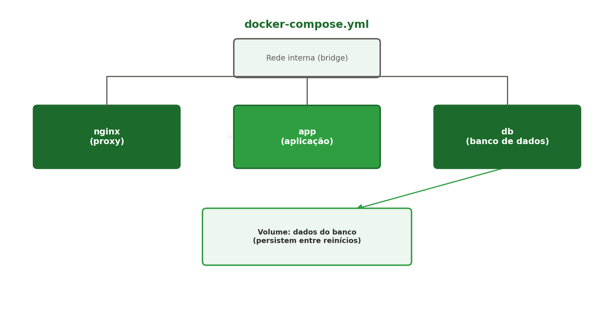

[← Anterior: Semana 11: Docker avançado](11-semana11-docker-avancado.md) | [Índice](../../README.md) | [Próximo: Semana 13: Introdução a CI/CD e GitHub Actions →](13-semana13-cicd-github-actions.md)

# Semana 12 — Docker Compose

## Teoria

Gerenciar vários containers relacionados (aplicação, banco de dados, proxy reverso) manualmente via `docker run` fica rapidamente inviável — são várias redes, volumes e parâmetros para lembrar. O **Docker Compose** resolve isso descrevendo toda a stack em um único arquivo `docker-compose.yml`:



## Comandos e configuração

Exemplo de `docker-compose.yml`, unindo a aplicação, um banco de dados e o Nginx como proxy reverso (reaproveitando o que foi configurado na Unidade 1):

```yaml
version: "3.9"

services:
  app:
    build: .
    expose:
      - "8000"
    networks:
      - rede-interna
    depends_on:
      - db

  db:
    image: postgres:16
    environment:
      POSTGRES_PASSWORD: senha123
      POSTGRES_DB: meubanco
    volumes:
      - dados_db:/var/lib/postgresql/data
    networks:
      - rede-interna

  nginx:
    image: nginx:alpine
    ports:
      - "80:80"
    volumes:
      - ./nginx.conf:/etc/nginx/conf.d/default.conf
    depends_on:
      - app
    networks:
      - rede-interna

networks:
  rede-interna:

volumes:
  dados_db:
```

- **`services`** — cada bloco é um container gerenciado pelo Compose.
- **`build: .`** — constrói a imagem a partir do `Dockerfile` na pasta atual, em vez de usar uma imagem pronta.
- **`depends_on`** — garante a ordem de inicialização (não espera a aplicação "estar pronta", só que o container já tenha subido).
- **`networks`** — todos os serviços na mesma rede interna conseguem se comunicar pelo nome do serviço (`db`, `app`).
- **`volumes`** — `dados_db` persiste os dados do banco entre reinícios.

Comandos principais:

```bash
# Subir toda a stack em segundo plano
docker compose up -d

# Ver o status dos serviços
docker compose ps

# Ver logs de todos os serviços (ou de um específico)
docker compose logs -f
docker compose logs -f app

# Parar e remover os containers (sem apagar os volumes)
docker compose down

# Parar e remover TAMBÉM os volumes (cuidado: apaga os dados)
docker compose down -v

# Reconstruir as imagens após uma mudança no código
docker compose up -d --build
```

## Exercícios

1. Monte um `docker-compose.yml` com a aplicação da Semana 10 e um banco de dados (`postgres` ou `mysql`), na mesma rede interna.
2. Adicione o Nginx como proxy reverso na frente da aplicação, reaproveitando os conceitos da Semana 7.
3. Confirme que os dados do banco persistem após `docker compose down` (sem `-v`) seguido de `docker compose up -d`.
4. Desafio: adicione um quarto serviço (ex.: um `redis` para cache) à stack, e explique, em texto, para que ele poderia servir numa aplicação real.

---

[← Anterior: Semana 11: Docker avançado](11-semana11-docker-avancado.md) | [Índice](../../README.md) | [Próximo: Semana 13: Introdução a CI/CD e GitHub Actions →](13-semana13-cicd-github-actions.md)
