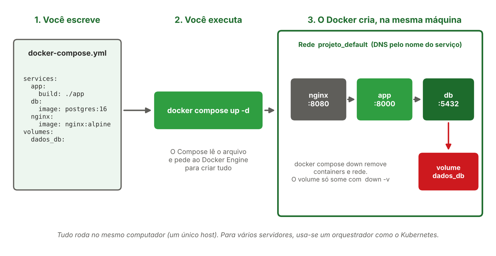

[← Anterior: Semana 11: Docker avançado](11-semana11-docker-avancado.md) | [Índice](../../README.md) | [Próximo: Semana 13: Introdução a CI/CD e GitHub Actions →](13-semana13-cicd-github-actions.md)

# Semana 12 — Docker Compose

## Teoria

### O que é o Docker Compose

Uma aplicação real raramente é um container só. Em geral há a aplicação, um banco de dados, um proxy reverso, talvez um cache. Subir tudo isso com `docker run` exige lembrar de várias redes, volumes, portas e variáveis, e repetir a mesma sequência de comandos toda vez.

O **Docker Compose** é uma ferramenta que permite **descrever uma stack inteira em um único arquivo** (`docker-compose.yml`) e controlá-la com poucos comandos. O arquivo é um texto em formato YAML, que pode ser versionado no Git junto com o código, seguindo a ideia de infraestrutura como código.

Pense assim: o `Dockerfile` descreve **uma imagem**, e o `docker-compose.yml` descreve **vários containers trabalhando juntos**.

> **Os containers rodam na sua própria máquina.** O Compose gerencia vários containers em **um único host** (o seu WSL2, um notebook ou um servidor). Para espalhar containers por vários servidores é preciso um orquestrador, como o Kubernetes (material complementar).

### Como funciona



Quando você roda `docker compose up -d`, o Compose faz, nesta ordem:

1. **Lê o arquivo** `docker-compose.yml` (e o arquivo `.env`, se existir, para preencher variáveis).
2. **Cria uma rede** própria do projeto, chamada `NOMEDAPASTA_default`. Todos os serviços entram nela.
3. **Cria os volumes** declarados.
4. **Constrói as imagens** dos serviços que têm `build`, ou baixa as que têm `image`.
5. **Inicia os containers** respeitando a ordem de `depends_on`. Cada um recebe o nome `NOMEDAPASTA-SERVICO-1`.

Dentro dessa rede, um serviço encontra o outro **pelo nome**: a aplicação acessa o banco em `db:5432` e o Nginx acessa a aplicação em `app:8000`, sem precisar saber IPs. É o mesmo comportamento das redes customizadas da Semana 11, só que automático.

O **nome do projeto** é, por padrão, o nome da pasta onde está o arquivo. Por isso cada stack deve ficar em uma pasta própria.

### Do `docker run` para o Compose

Tudo que você já fez com `docker run` tem um equivalente no arquivo:

| No `docker run` | No `docker-compose.yml` |
|---|---|
| `docker build -t app .` | `build: ./app` |
| imagem no final do comando | `image: nginx:alpine` |
| `--name` | nome do serviço (`app`, `db`) |
| `-p 8080:80` | `ports: ["8080:80"]` |
| `-e VARIAVEL=valor` | `environment:` |
| `-v dados:/pasta` | `volumes:` |
| `--network` | automático (rede padrão do projeto) |
| `--restart unless-stopped` | `restart: unless-stopped` |
| `--health-interval` e semelhantes | `healthcheck:` |

> **Atenção ao nome do comando:** nas versões atuais do Docker, o Compose é um plugin chamado com um espaço, `docker compose`. O antigo `docker-compose` (com hífen) é a versão 1, já descontinuada. Nos arquivos atuais também **não é mais necessário** escrever `version: "3.9"` no topo, o Compose ignora e avisa que está obsoleto.

## Exemplo de arquivo

Stack com a aplicação, um banco de dados e o Nginx como proxy reverso (retomando o que foi configurado na Unidade 1):

```yaml
services:
  app:
    build: ./app
    expose:
      - "8000"
    depends_on:
      db:
        condition: service_healthy

  db:
    image: postgres:16
    environment:
      POSTGRES_PASSWORD: ${POSTGRES_PASSWORD}
      POSTGRES_DB: meubanco
    volumes:
      - dados_db:/var/lib/postgresql/data
    healthcheck:
      test: ["CMD-SHELL", "pg_isready -U postgres -d meubanco"]
      interval: 5s
      timeout: 3s
      retries: 5

  nginx:
    image: nginx:alpine
    ports:
      - "8080:80"
    volumes:
      - ./nginx.conf:/etc/nginx/conf.d/default.conf:ro
    depends_on:
      - app

volumes:
  dados_db:
```

- **`services`**: cada bloco é um container gerenciado pelo Compose.
- **`build: ./app`**: constrói a imagem a partir do `Dockerfile` da pasta `app`, em vez de usar uma imagem pronta.
- **`expose`**: documenta a porta usada dentro da rede interna, sem publicá-la no computador. Quem aparece para fora é só o Nginx, com `ports`.
- **`ports`**: publica a porta no seu computador, no formato `PORTA_DO_HOST:PORTA_DO_CONTAINER`.
- **`depends_on`**: controla a ordem de inicialização. Na forma simples, só espera o container **iniciar**. Com `condition: service_healthy`, espera o serviço ficar **saudável**, usando o `HEALTHCHECK` que você viu na Semana 11.
- **`healthcheck`**: o teste de saúde do banco. O `pg_isready` confirma que o PostgreSQL já aceita conexões.
- **`${POSTGRES_PASSWORD}`**: o valor vem do arquivo `.env`, e não fica escrito no `docker-compose.yml`. Lembre dos seminários sobre segredos: o `.env` **não deve ir para o Git**.
- **`volumes`**: `dados_db` guarda os dados do banco e sobrevive a reinícios.
- **Rede**: não foi preciso declarar. O Compose cria a rede padrão e coloca todos os serviços nela.

### Comandos principais

```bash
# Validar o arquivo e ver o resultado final, já com as variáveis preenchidas
docker compose config

# Subir toda a stack em segundo plano
docker compose up -d

# Ver o status dos serviços
docker compose ps

# Ver logs de todos os serviços (ou de um específico)
docker compose logs -f
docker compose logs -f app

# Executar um comando dentro de um serviço
docker compose exec db psql -U postgres -d meubanco

# Parar e remover os containers e a rede (sem apagar os volumes)
docker compose down

# Parar e remover TAMBÉM os volumes (cuidado: apaga os dados)
docker compose down -v

# Reconstruir as imagens após uma mudança no código
docker compose up -d --build
```

Os comandos `start`, `stop` e `restart` também existem (`docker compose stop`, por exemplo), e agem sobre os containers sem removê-los.

## Prática: montando uma stack com Compose

Você vai montar a stack do exemplo acima, testar a comunicação entre os serviços e comprovar a persistência dos dados.

**0. Confirme que o Docker Compose está instalado**

Antes de começar, verifique se o Compose está disponível no seu WSL2:

```bash
docker compose version
```

Se aparecer algo como `Docker Compose version v2.x.x`, siga para o passo 1. Se der erro de comando não encontrado, veja abaixo qual é o seu caso.

| Como o Docker foi instalado | O Compose já vem? |
|---|---|
| Docker Desktop no Windows, com a integração WSL ativada | Sim, não precisa instalar nada |
| Docker Engine pelo repositório oficial da Docker | Normalmente sim (pacote `docker-compose-plugin`) |
| Pacote `docker.io` do Ubuntu | Em geral não, é preciso instalar |

Para instalar no Ubuntu do WSL2:

```bash
sudo apt update
sudo apt install docker-compose-v2
```

Se o `apt` não encontrar esse pacote, use o nome `docker-compose-plugin`, que vem do repositório oficial da Docker. Depois confirme novamente com `docker compose version`.

> **Se você usa o Docker Desktop**, abra Settings, Resources, WSL Integration e confirme que a sua distribuição está ativada. Sem isso, o comando `docker` não aparece dentro do WSL2.

> **Não instale o pacote `docker-compose`** (com hífen). Ele é a versão 1, descontinuada, e usa o comando antigo `docker-compose`. Neste material usamos sempre `docker compose`, com espaço.

**1. Crie a estrutura de pastas**

```bash
mkdir -p ~/stack/app
cd ~/stack

echo "<h1>Minha stack com Docker Compose</h1>" > app/index.html
nano app/Dockerfile
```

Conteúdo do `app/Dockerfile`:

```dockerfile
FROM python:3.12-slim
WORKDIR /app
COPY index.html .
EXPOSE 8000
CMD ["python3", "-m", "http.server", "8000"]
```

**2. Crie a configuração do Nginx (proxy reverso)**

```bash
cat > nginx.conf << 'EOF'
server {
    listen 80;

    location / {
        proxy_pass http://app:8000;
        proxy_set_header Host $host;
        proxy_set_header X-Real-IP $remote_addr;
    }
}
EOF
```

Repare que o `proxy_pass` usa `http://app:8000`. Quem resolve o nome `app` é a rede do Compose.

**3. Crie o arquivo de segredos e proteja-o**

```bash
echo "POSTGRES_PASSWORD=troque_esta_senha" > .env
echo ".env" > .gitignore
```

**4. Crie o `docker-compose.yml`**

```bash
nano docker-compose.yml
```

Cole o conteúdo da seção "Exemplo de arquivo" e confira que a estrutura ficou assim:

```
~/stack/
  app/
    Dockerfile
    index.html
  .env
  .gitignore
  docker-compose.yml
  nginx.conf
```

**5. Valide e suba a stack**

```bash
docker compose config
docker compose up -d
docker compose ps
```

Acompanhe o `docker compose ps`: o `db` passa por `starting` e chega a `healthy`, e só então a aplicação inicia. Se algo falhar, use `docker compose logs`.

**6. Teste a stack**

```bash
# Pelo Nginx, que publica a porta 8080
curl http://localhost:8080

# A aplicação NÃO é acessível diretamente: ela só usa expose, sem ports
curl http://localhost:8000

# Comunicação interna pelo nome do serviço
docker compose exec nginx wget -qO- http://app:8000
docker compose exec app python3 -c "import socket; print(socket.gethostbyname('db'))"
```

Abra também `http://localhost:8080` no navegador do Windows. O segundo comando deve falhar (conexão recusada), e o último mostra o IP interno do banco, resolvido pelo nome `db`.

**7. Comprove a persistência dos dados**

```bash
# Criar uma tabela e inserir um registro
docker compose exec db psql -U postgres -d meubanco -c "CREATE TABLE alunos (id serial PRIMARY KEY, nome text);"
docker compose exec db psql -U postgres -d meubanco -c "INSERT INTO alunos (nome) VALUES ('Maria');"
docker compose exec db psql -U postgres -d meubanco -c "SELECT * FROM alunos;"

# Derrubar e subir de novo, sem apagar volumes
docker compose down
docker compose up -d
docker compose ps

# O registro deve continuar lá
docker compose exec db psql -U postgres -d meubanco -c "SELECT * FROM alunos;"
```

Agora derrube **apagando o volume** e compare:

```bash
docker compose down -v
docker compose up -d

# Aguarde ficar healthy e consulte: a tabela não existe mais
docker compose exec db psql -U postgres -d meubanco -c "SELECT * FROM alunos;"
```

**8. Altere a aplicação e reconstrua**

```bash
echo "<h1>Versão 2 da minha stack</h1>" > app/index.html
docker compose up -d --build
curl http://localhost:8080
```

**9. Perguntas para responder**

- Por que o `curl http://localhost:8000` falha, se a aplicação está rodando? Que vantagem isso traz para a segurança?
- O que mudaria se o `depends_on` do `app` não tivesse `condition: service_healthy`?
- Qual é a diferença de efeito entre `docker compose down` e `docker compose down -v`?
- Se você enviar este projeto para o GitHub, quais arquivos não podem ir? Por quê?

**10. Limpeza**

```bash
docker compose down -v
```

## Compose com dois ambientes: desenvolvimento e produção

A mesma aplicação costuma rodar em ambientes diferentes, e cada um tem necessidades próprias:

| | Desenvolvimento | Produção |
|---|---|---|
| **Código** | Montado do seu computador em um volume, e a alteração aparece na hora | Dentro da imagem, versionada e imutável |
| **Imagem** | Construída localmente (`build`) | Imagem publicada com tag (`image`), vinda de um registry |
| **Portas** | Abertas para depuração (banco, ferramentas de administração), só no `localhost` | Somente o Nginx fica exposto |
| **Reinício** | Não precisa | `restart: unless-stopped` |
| **Senhas** | `.env` local, com valores de teste | `.env` no servidor, nunca no Git |
| **Extras** | Ferramentas de apoio (por exemplo, um painel do banco) | Só o que a aplicação precisa |

Manter dois arquivos completos e quase iguais gera erro e retrabalho. O Compose resolve isso com **arquivos de sobreposição**: um arquivo **base** com o que é comum e um arquivo **específico** de cada ambiente, que só descreve o que muda.

```
docker-compose.yml            (base: o que é igual nos dois ambientes)
docker-compose.override.yml   (desenvolvimento: carregado automaticamente)
docker-compose.prod.yml       (produção: escolhido com -f)
```

### Como o Compose combina os arquivos

- Quando você roda `docker compose up` **sem** `-f`, o Compose lê o `docker-compose.yml` e **também** o `docker-compose.override.yml`, se existir. Por isso o override é o lugar natural do ambiente de desenvolvimento.
- Quando você usa `-f`, **só os arquivos listados** são lidos, na ordem. O override automático **não** é carregado.
- Valores simples (como `image` e `restart`) do arquivo seguinte **substituem** os do anterior. Listas (como `ports` e `volumes`) são **somadas**. Mapas (como `environment`) são **mesclados**.

```bash
# Desenvolvimento: base + override, automático
docker compose up -d

# Produção: base + arquivo de produção, escolhido por você
docker compose -f docker-compose.yml -f docker-compose.prod.yml up -d

# Conferir o resultado final da combinação, sem subir nada
docker compose -f docker-compose.yml -f docker-compose.prod.yml config
```

Para rodar os dois ambientes ao mesmo tempo na mesma máquina, dê **um nome de projeto diferente** ao segundo, com `-p`. Sem isso, o Compose usaria o mesmo nome (o da pasta) e um ambiente sobrescreveria o outro, incluindo containers, rede e volume.

```bash
docker compose -p stack-prod -f docker-compose.yml -f docker-compose.prod.yml up -d
```

> Dica: um serviço pode existir só no arquivo de desenvolvimento. Ele simplesmente não aparece em produção.

## Prática: dois ambientes com a mesma stack

Você vai transformar a stack da prática anterior (`~/stack`) em dois ambientes: um de desenvolvimento, com alterações instantâneas e um painel do banco, e um de produção, enxuto e exposto só pelo Nginx.

**1. Limpe a prática anterior**

```bash
cd ~/stack
docker compose down -v
```

**2. Reescreva o arquivo base**

O arquivo base fica só com o que é comum. Repare que o serviço `app` não tem `build` nem `image`, e o Nginx não tem `ports`: isso é decidido em cada ambiente.

```bash
nano docker-compose.yml
```

```yaml
services:
  app:
    expose:
      - "8000"
    depends_on:
      db:
        condition: service_healthy

  db:
    image: postgres:16
    environment:
      POSTGRES_PASSWORD: ${POSTGRES_PASSWORD}
      POSTGRES_DB: meubanco
    volumes:
      - dados_db:/var/lib/postgresql/data
    healthcheck:
      test: ["CMD-SHELL", "pg_isready -U postgres -d meubanco"]
      interval: 5s
      timeout: 3s
      retries: 5

  nginx:
    image: nginx:alpine
    volumes:
      - ./nginx.conf:/etc/nginx/conf.d/default.conf:ro
    depends_on:
      - app

volumes:
  dados_db:
```

**3. Crie o arquivo de desenvolvimento (override)**

```bash
nano docker-compose.override.yml
```

```yaml
services:
  app:
    build: ./app
    volumes:
      - ./app:/app

  db:
    ports:
      - "127.0.0.1:5432:5432"

  nginx:
    ports:
      - "8080:80"

  adminer:
    image: adminer
    ports:
      - "127.0.0.1:8081:8080"
    depends_on:
      - db
```

O `127.0.0.1:` na frente da porta faz o banco e o painel ficarem acessíveis **somente do seu computador**, e não da rede.

**4. Crie o arquivo de produção**

```bash
nano docker-compose.prod.yml
```

```yaml
services:
  app:
    image: stack-app:prod
    restart: unless-stopped

  db:
    restart: unless-stopped

  nginx:
    ports:
      - "8090:80"
    restart: unless-stopped
```

Num projeto real, a imagem de produção viria de um registry (por exemplo, `ghcr.io/SEU_USUARIO/stack-app:1.0`). Aqui usamos uma imagem construída localmente com a tag `prod` para simular isso.

**5. Suba o ambiente de desenvolvimento**

```bash
docker compose up -d
docker compose ps

curl http://localhost:8080
```

Abra o painel do banco em `http://localhost:8081`. Escolha o sistema **PostgreSQL**, servidor `db`, usuário `postgres`, a senha do seu `.env` e o banco `meubanco`.

**6. Veja a alteração instantânea**

```bash
echo "<h1>Alterei no ambiente de desenvolvimento</h1>" > app/index.html
curl http://localhost:8080
```

A página mudou **sem reconstruir a imagem**, porque a pasta `app` do seu computador está montada dentro do container.

**7. Suba o ambiente de produção ao lado**

```bash
# Gerar a imagem de produção (o código vai para dentro dela)
docker build -t stack-app:prod ./app

# Subir com outro nome de projeto, para não colidir com o desenvolvimento
docker compose -p stack-prod -f docker-compose.yml -f docker-compose.prod.yml up -d
docker compose -p stack-prod ps

curl http://localhost:8090
```

Agora altere o `app/index.html` de novo e compare:

```bash
echo "<h1>Segunda alteração</h1>" > app/index.html
curl http://localhost:8080
curl http://localhost:8090
```

A porta 8080 (desenvolvimento) mostra a página nova. A 8090 (produção) continua com a anterior, porque o código está **dentro da imagem**. Para atualizar a produção seria preciso gerar uma nova imagem e subir de novo.

**8. Compare os dois ambientes**

```bash
docker ps
docker compose config
docker compose -p stack-prod -f docker-compose.yml -f docker-compose.prod.yml config
```

Confira quais portas estão publicadas em cada ambiente e o que existe só no desenvolvimento (o `adminer`).

**9. Perguntas para responder**

- Por que o serviço `app` do arquivo base não tem `build` nem `image`?
- O que acontece com o `docker-compose.override.yml` quando você usa `-f` para escolher os arquivos?
- Por que a porta do banco no desenvolvimento usa `127.0.0.1:5432:5432` e não apenas `5432:5432`?
- Para que serve o `-p stack-prod`? O que aconteceria sem ele?
- Qual é o risco de usar o ambiente de desenvolvimento (com volume e portas abertas) em um servidor real?

**10. Limpeza**

```bash
docker compose down -v
docker compose -p stack-prod -f docker-compose.yml -f docker-compose.prod.yml down -v
docker rmi stack-app:prod
```

## Exercícios

1. Faça a prática completa e responda às perguntas do passo 9.
2. Reescreva, em texto, o serviço `db` do arquivo como um comando `docker run`, usando a tabela de equivalências.
3. Mude a porta publicada do Nginx para `8081` e confirme o resultado com `docker compose ps` e `curl`.
4. Limite a memória do serviço `app` adicionando `mem_limit: 128m` e confirme o limite com `docker stats --no-stream`.
5. Desafio: adicione um quarto serviço à stack (por exemplo, um `redis`) e explique, em texto, para que ele poderia servir em uma aplicação real.
6. Faça a prática dos dois ambientes e responda às perguntas do passo 9.
7. Acrescente ao ambiente de desenvolvimento um serviço de apoio que não existe em produção (por exemplo, `redis-commander` ou um serviço de e-mail de teste) e confirme que ele não aparece na produção.
8. Desafio: no arquivo de produção, remova a porta publicada do Nginx e coloque `80:80`. Explique por que isso pode falhar no WSL2 se o Nginx da Unidade 1 estiver rodando, e como descobrir quem está usando a porta (use o `ss` ou o `netstat -natp` que você viu no complemento de redes).

---

[← Anterior: Semana 11: Docker avançado](11-semana11-docker-avancado.md) | [Índice](../../README.md) | [Próximo: Semana 13: Introdução a CI/CD e GitHub Actions →](13-semana13-cicd-github-actions.md)
