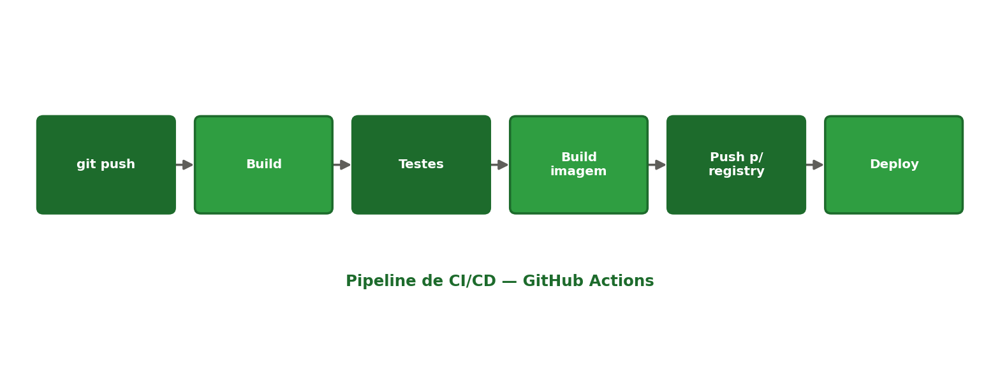

[← Anterior: Semana 12: Docker Compose](12-semana12-docker-compose.md) | [Índice](../../README.md) | [Próximo: Semana 14: Pipeline completo e lançamento do projeto →](14-semana14-pipeline-completo.md)

# Semana 13 — Introdução a CI/CD e GitHub Actions

## Git e GitHub: o básico para o pipeline

O GitHub Actions só dispara quando o código chega ao GitHub. Por isso, antes do workflow, é preciso dominar o básico do Git e saber conectar o seu computador à sua conta.

- **Git** é o programa de controle de versão que roda na sua máquina.
- **GitHub** é o serviço na internet que guarda os repositórios e executa o GitHub Actions.

> **Nesta semana, não use o WSL2.** Faça tudo direto na sua máquina (a máquina hospedeira), usando o **terminal integrado do VS Code** (menu **Terminal, New Terminal**, ou `Ctrl + '`). No Windows, ele abre o **PowerShell** por padrão, e os comandos abaixo foram escritos para ele. Em macOS e Linux, os comandos do Git são os mesmos.

### Instalar e se identificar

No Windows, instale o **Git for Windows** (https://git-scm.com/download/win) ou use o terminal:

```powershell
winget install --id Git.Git -e
```

Depois da instalação, **feche e abra o VS Code de novo** para que o terminal reconheça o comando `git`.

```bash
git --version

# Identidade que aparece nos seus commits (use o mesmo e-mail da conta do GitHub)
git config --global user.name "Seu Nome"
git config --global user.email "seu-email@exemplo.com"
git config --global init.defaultBranch main

# Conferir
git config --global --list
```

### Conectar o seu computador à sua conta do GitHub

O GitHub **não aceita mais a senha da conta** para enviar código pelo terminal. Há quatro caminhos. Escolha **um**.

**Opção A: chave SSH (recomendada).** Você cria um par de chaves, entrega a pública ao GitHub e nunca mais digita senha.

```bash
# 1. Gerar a chave (aceite o local padrão; a frase secreta é opcional, mas recomendada)
ssh-keygen -t ed25519 -C "seu-email@exemplo.com"

# 2. Mostrar a chave PÚBLICA e copiar todo o texto
cat ~/.ssh/id_ed25519.pub
```

3. No GitHub, acesse **Settings, SSH and GPG keys, New SSH key**, dê um nome (por exemplo, "Notebook pessoal") e cole a chave pública.
4. Teste a conexão:

```bash
ssh -T git@github.com
# Esperado: Hi seu-usuario! You've successfully authenticated, but GitHub does not provide shell access.
```

Com SSH, os repositórios são clonados com o endereço no formato `git@github.com:usuario/repositorio.git`.

> Nunca compartilhe o arquivo `id_ed25519` (a chave **privada**). Só o `.pub` vai para o GitHub.

**Opção B: HTTPS com token de acesso pessoal (PAT).** O token faz o papel da senha.

1. No GitHub, acesse **Settings, Developer settings, Personal access tokens, Fine-grained tokens, Generate new token**.
2. Escolha o repositório, a validade e a permissão **Contents: Read and write**.
3. Copie o token (ele só aparece uma vez).
4. Ao fazer `git push` por HTTPS, informe o seu **usuário** e use o **token no lugar da senha**. Para não digitar sempre:

```bash
# No Windows, o Git for Windows já inclui o Git Credential Manager: na primeira vez ele pede o login
# e guarda o token com segurança no cofre do Windows. Nada a configurar.
```

**Opção C: GitHub CLI (`gh`).** Faz o login pelo navegador e configura as credenciais sozinho.

```bash
winget install --id GitHub.cli -e   # Windows (feche e abra o terminal depois)
gh auth login
# Escolha: GitHub.com, o protocolo (SSH ou HTTPS) e "Login with a web browser"
gh auth status
```

**Opção D: entrar com a conta do GitHub pelo VS Code.** Como você vai usar o terminal do VS Code, esta é a forma mais direta: o login é feito pelo navegador, sem criar chave nem token à mão.

1. No VS Code, clique no ícone de **Contas** (o bonequinho, no canto inferior esquerdo) e escolha **Sign in with GitHub** (ou **Turn on Backup and Sync / Sign in to Sync Settings**, que também pede a conta).
2. O navegador abre na página do GitHub. Entre com o seu usuário, clique em **Authorize Visual Studio Code** e, quando o navegador pedir, permita abrir o VS Code.
3. De volta ao VS Code, o ícone de Contas passa a mostrar o seu usuário do GitHub.
4. Use um repositório com endereço **HTTPS** (`https://github.com/SEU-USUARIO/meu-projeto-ci.git`), e não o endereço SSH. Na primeira vez que você rodar `git push`, `git pull` ou `git clone` no terminal do VS Code, ele abre uma janela pedindo para entrar com o GitHub. Escolha **Allow** e confirme no navegador.

Também dá para clonar sem digitar comando: abra a paleta (`Ctrl + Shift + P`), execute **Git: Clone**, escolha **Clone from GitHub** e selecione o repositório da lista.

Para abrir e revisar pull requests dentro do próprio editor, instale a extensão **GitHub Pull Requests** (da Microsoft e do GitHub).

> A autenticação do VS Code vale só para o VS Code. Se você abrir um terminal fora dele (por exemplo, o PowerShell do Windows), o `git push` volta a pedir login pelas outras opções.

> **Segurança:** token, chave privada e `.env` **nunca** entram em um commit. Se um token vazar, revogue-o imediatamente em Settings.

### Comandos básicos do Git

| Comando | O que faz |
|---|---|
| `git init` | Cria um repositório novo na pasta atual |
| `git clone <url>` | Copia um repositório do GitHub para a sua máquina |
| `git status` | Mostra o que mudou e o que está pronto para o commit |
| `git add <arquivo>` | Coloca a alteração na área de preparação (`git add .` adiciona tudo) |
| `git commit -m "mensagem"` | Registra as alterações preparadas como uma versão |
| `git log --oneline` | Lista o histórico de commits de forma resumida |
| `git diff` | Mostra as linhas alteradas ainda não preparadas |
| `git remote -v` | Mostra para onde o repositório envia e de onde recebe |
| `git push` | Envia seus commits ao GitHub |
| `git pull` | Traz do GitHub os commits novos e junta ao seu código |
| `git branch` | Lista as branches (ramos de trabalho) |
| `git switch -c <nome>` | Cria uma branch nova e muda para ela |
| `git switch <nome>` | Muda para uma branch existente |
| `git merge <nome>` | Junta a branch indicada na branch atual |

### Primeiro repositório, do zero ao GitHub

1. No GitHub, clique em **New repository**, dê um nome (por exemplo, `meu-projeto-ci`) e crie **sem** README.
2. No terminal:

```bash
mkdir meu-projeto-ci
cd meu-projeto-ci
code .   # abre a pasta em uma nova janela do VS Code; continue no terminal dessa janela
git init
# Crie o arquivo README.md no VS Code, escreva uma linha (por exemplo, # Meu projeto CI) e salve

git add .
git commit -m "Primeiro commit"

# Conectar ao repositório criado.
# O endereço precisa combinar com a opção de login escolhida acima:
#   Opções B, C e D (token, gh, VS Code): endereço HTTPS
#   Opção A (chave SSH): endereço SSH, git@github.com:SEU-USUARIO/meu-projeto-ci.git
git remote add origin https://github.com/SEU-USUARIO/meu-projeto-ci.git
git branch -M main
git push -u origin main
```


Atualize a página do repositório no GitHub e confira se os arquivos apareceram.

### Fluxo com branch e pull request

É o fluxo usado em equipe, e o que o projeto final exige (revisão cruzada):

```bash
git pull                              # começa atualizado
git switch -c ajusta-readme           # trabalha em uma branch própria
# ... edite os arquivos ...
git add .
git commit -m "Ajusta o README"
git push -u origin ajusta-readme      # envia a branch
```

No GitHub, aparece o botão **Compare & pull request**. Abra o PR, peça a revisão de outra pessoa e faça o **merge**. Depois, volte para a `main` e atualize:

```bash
git switch main
git pull
```

## Publicando uma página com GitHub Pages

O **GitHub Pages** publica páginas estáticas (HTML, CSS e JavaScript) direto de um repositório, em um endereço como `https://seu-usuario.github.io/nome-do-repositorio/`. Nas contas gratuitas, funciona em repositórios públicos.

**Forma simples, sem workflow:**

1. Crie um arquivo `index.html` na raiz do repositório (no VS Code, **New File**), com o conteúdo abaixo:

   ```html
   <!DOCTYPE html>
   <html lang="pt-BR">
   <head>
     <meta charset="UTF-8">
     <meta name="viewport" content="width=device-width, initial-scale=1.0">
     <title>Minha primeira página no GitHub Pages</title>
     <style>
       body { font-family: Arial, sans-serif; max-width: 600px; margin: 60px auto; text-align: center; }
       h1 { color: #2F9E41; }
     </style>
   </head>
   <body>
     <h1>Olá, GitHub Pages!</h1>
     <p>Esta página foi publicada a partir de um repositório Git.</p>
   </body>
   </html>
   ```

   Depois, envie para o `main` pelo terminal do VS Code:

   ```powershell
   git add index.html
   git commit -m "Adiciona index.html"
   git push
   ```

   Confira no GitHub se o arquivo apareceu na lista de arquivos do repositório.
2. No GitHub, acesse **Settings, Pages**.
3. Em **Build and deployment**, escolha **Deploy from a branch**, selecione a branch `main` e a pasta `/ (root)` e clique em **Save**.
4. Em um ou dois minutos, o endereço da página aparece nessa tela.

## Teoria

**CI/CD** significa **Integração Contínua** (Continuous Integration) e **Entrega/Implantação Contínua** (Continuous Delivery/Deployment):

- **Integração Contínua**: toda vez que um código é enviado ao repositório, ele é automaticamente construído e testado — detectando problemas cedo, antes de chegarem a produção.
- **Entrega/Implantação Contínua**: o processo de levar essa mudança, já validada, até o ambiente de produção — de forma automatizada, em vez de manual.



O **GitHub Actions** é a ferramenta de CI/CD integrada ao GitHub. Um workflow é definido em um arquivo YAML dentro de `.github/workflows/`, e é disparado por eventos do repositório (um `push`, um `pull request`, etc.).

## Estrutura de um workflow

```yaml
# .github/workflows/ci.yml
name: CI

on:
  push:
    branches: [main]
  pull_request:
    branches: [main]

jobs:
  build-e-testes:
    runs-on: ubuntu-latest

    steps:
      - name: Baixar o código do repositório
        uses: actions/checkout@v4

      - name: Configurar o Python
        uses: actions/setup-python@v5
        with:
          python-version: "3.12"

      - name: Instalar dependências
        run: pip install -r requirements.txt

      - name: Rodar os testes
        run: pytest
```

- **`on`** — define os eventos que disparam o workflow (aqui, `push` ou `pull request` na branch `main`).
- **`jobs`** — um workflow pode ter um ou mais jobs, cada um rodando em uma máquina virtual própria (`runs-on`).
- **`steps`** — a sequência de passos de um job, executados em ordem.
- **`uses`** — reutiliza uma *action* pronta, feita pela comunidade ou pelo próprio GitHub (ex.: `actions/checkout` baixa o código do repositório para a máquina do workflow).
- **`run`** — executa um comando shell diretamente.

## Do commit ao workflow

Não há um "comando" para rodar o GitHub Actions localmente: ele roda automaticamente nos servidores do GitHub sempre que o evento configurado acontece. Com o Git configurado, o fluxo típico é:

```bash
# 1. Crie a pasta e o arquivo de workflow no seu projeto
mkdir .github\workflows
# abre o arquivo ci.yml no VS Code: copie para ele o exemplo da seção "Estrutura de um workflow" e salve
code .github/workflows/ci.yml

# 2. Adicione, faça commit e envie para o GitHub
git add .github/workflows/ci.yml
git commit -m "Adiciona pipeline de CI"
git push
```

Depois do `push`, acesse a aba **Actions** do repositório no GitHub para acompanhar a execução do workflow em tempo real.

## Automatizando o deploy com GitHub Actions

Em vez de configurar o Pages à mão, dá para automatizar o deploy da página da seção "Publicando uma página com GitHub Pages" com um workflow do GitHub Actions (`actions/deploy-pages`), o que combina com o tema da semana: a cada `push` no `main`, o pipeline publica a página sozinho.

1. Em **Settings, Pages**, na opção **Source**, escolha **GitHub Actions**.
2. Crie a pasta `site/` e mova o `index.html` para dentro dela (`mkdir site` e `git mv index.html site/index.html`). Crie também o arquivo `.github/workflows/pages.yml`:

```yaml
name: Publicar no GitHub Pages

on:
  push:
    branches: [main]

permissions:
  contents: read
  pages: write
  id-token: write

concurrency:
  group: pages
  cancel-in-progress: true

jobs:
  deploy:
    runs-on: ubuntu-latest
    environment:
      name: github-pages
      url: ${{ steps.deployment.outputs.page_url }}

    steps:
      - name: Baixar o código
        uses: actions/checkout@v4

      - name: Configurar o Pages
        uses: actions/configure-pages@v5

      - name: Empacotar a pasta site
        uses: actions/upload-pages-artifact@v3
        with:
          path: site

      - name: Publicar
        id: deployment
        uses: actions/deploy-pages@v4
```

3. Envie as alterações:

   ```powershell
   git add .
   git commit -m "Publica a pagina com GitHub Actions"
   git push
   ```

   Na aba **Actions**, acompanhe a execução. Ao final, o endereço publicado aparece no job `deploy`.

Pontos para observar:

- **`permissions`**: o workflow precisa de permissão para escrever no Pages. Sem isso, o deploy falha.
- **`path: site`**: só o conteúdo dessa pasta é publicado, e não o repositório inteiro.
- **`environment`**: registra cada publicação na aba **Deployments** do repositório.

## A mesma página em um container

O GitHub Pages hospeda a página para você. Com Docker, **você** empacota a página junto com o servidor web e a executa onde quiser. O `index.html` é o mesmo da página do GitHub Pages, guardado na pasta `site/`. O que muda é quem serve o arquivo: um container com **Nginx**.

Na raiz do repositório, crie o arquivo `Dockerfile`:

```dockerfile
FROM nginx:1.27-alpine
COPY site/ /usr/share/nginx/html/
```

- **`FROM`**: parte de uma imagem pronta do Nginx, com versão fixada.
- **`COPY`**: copia o conteúdo de `site/` para a pasta que o Nginx publica.

> Para rodar o Docker no terminal do VS Code no Windows, é preciso ter o Docker Desktop instalado e aberto. Se preferir, esta parte local pode ser feita no terminal do WSL2, como nas semanas anteriores. O workflow abaixo roda nos servidores do GitHub e não depende do Docker da sua máquina.

Para testar localmente:

```powershell
docker build -t minha-pagina .
docker run -d -p 8080:80 --name pagina minha-pagina
```

Abra `http://localhost:8080` no navegador. Para encerrar e remover o container:

```powershell
docker rm -f pagina
```

### Testando a imagem no pipeline

Agora o pipeline passa a fazer o que o GitHub Pages não faz: **construir a imagem, subir o container e verificar se a página responde**. Crie o arquivo `.github/workflows/docker.yml`:

```yaml
name: Build e teste da imagem

on:
  push:
    branches: [main]
  pull_request:
    branches: [main]

jobs:
  build-e-teste:
    runs-on: ubuntu-latest

    steps:
      - name: Baixar o código
        uses: actions/checkout@v4

      - name: Construir a imagem
        run: docker build -t minha-pagina:${{ github.sha }} .

      - name: Subir o container
        run: docker run -d --name pagina -p 8080:80 minha-pagina:${{ github.sha }}

      - name: Testar a página
        run: |
          sleep 3
          curl --fail --silent http://localhost:8080 | grep "Olá, GitHub Pages!"

      - name: Mostrar os logs se algo falhou
        if: failure()
        run: docker logs pagina
```

O que cada parte faz:

- **`github.sha`**: identificador do commit, usado como tag da imagem. Cada versão fica identificável.
- **`curl --fail`**: faz o comando falhar se o servidor devolver erro (por exemplo, 404). Sem isso, o passo ficaria verde mesmo com a página quebrada.
- **`grep`**: confere se o texto esperado está na página. Se não estiver, o passo falha e o pipeline fica vermelho.
- **`if: failure()`**: este passo só roda quando algum passo anterior falhou, e mostra os logs do container para ajudar a achar o erro.

Envie as alterações:

```powershell
git add .
git commit -m "Adiciona Dockerfile e workflow da imagem"
git push
```

Na aba **Actions**, acompanhe o workflow. Para ver o pipeline falhar, troque o texto do `grep` por uma frase que não existe na página e envie de novo.

> Este pipeline constrói e testa a imagem, mas **não coloca a página no ar** para o público. Para isso, é preciso enviar a imagem ao GHCR e rodá-la em um servidor, que é exatamente o que o projeto final pede.

## Alternativas ao GitHub Actions

O GitHub Actions é uma entre várias ferramentas de CI/CD. Os conceitos (pipeline, jobs, etapas, gatilhos) são os mesmos, mudando a sintaxe e onde o pipeline roda.

| Ferramenta | Característica principal |
|---|---|
| **GitLab CI/CD** | Integrada ao GitLab, com pipeline definido em `.gitlab-ci.yml`. Pode ser usada na nuvem ou instalada em servidor próprio |
| **Jenkins** | Software livre que você instala e administra. Muito usado em empresas, com milhares de plugins |
| **CircleCI** | Serviço na nuvem focado em velocidade, com configuração em `.circleci/config.yml` |
| **Azure Pipelines** | CI/CD do Azure DevOps, com forte integração ao ecossistema Microsoft |
| **Bitbucket Pipelines** | Integrado ao Bitbucket, com configuração em `bitbucket-pipelines.yml` |
| **Travis CI** | Um dos primeiros serviços de CI na nuvem, hoje menos usado que os demais |
| **Gitea Actions e Forgejo Actions** | Alternativas de código aberto para hospedagem própria, com sintaxe muito parecida com a do GitHub Actions |
| **Drone e Woodpecker CI** | Ferramentas leves de código aberto, em que cada etapa do pipeline roda em um container |
| **AWS CodePipeline e Google Cloud Build** | Serviços de CI/CD das nuvens da AWS e do Google, integrados aos demais serviços de cada provedor |
| **Argo CD** | Focado só na entrega (CD), muito usado com Kubernetes |

Para escolher, vale considerar onde o código já está hospedado, se a ferramenta é na nuvem ou instalada por você, o custo e o suporte da comunidade.

## Exercícios

1. Instale e configure o Git na sua máquina (`user.name` e `user.email`), conecte à sua conta do GitHub (por SSH, token, `gh` ou pelo login do VS Code) e prove que funcionou enviando um commit com `git push`.
2. Crie um repositório no GitHub com o projeto da Semana 10 (ou 12) e adicione um workflow simples que só imprime uma mensagem (`run: echo "Rodando CI"`).
3. Adicione um step que instale as dependências do seu projeto e rode algum tipo de verificação (pode ser um teste simples, ou até um `python3 -m py_compile` validando a sintaxe do código).
4. Faça o workflow falhar de propósito (ex.: um comando inexistente) e observe, na aba Actions do GitHub, como o erro é reportado.
5. Crie uma branch, altere o README e abra um pull request pelo GitHub. Observe o workflow rodando no PR antes do merge.
6. Crie uma página `index.html` simples, publique com o GitHub Pages pela forma simples e depois automatize o deploy com `actions/deploy-pages`. Altere o HTML, faça o `push` e veja a página atualizar sozinha.
7. Crie o `Dockerfile` da página, rode o container com `docker run` e crie o workflow `docker.yml`. Faça o teste com `curl` falhar de propósito e depois corrija.
8. Desafio: configure o workflow para rodar também quando um `pull request` for aberto, e explique, em texto, por que isso é uma boa prática em equipes.

---

[← Anterior: Semana 12: Docker Compose](12-semana12-docker-compose.md) | [Índice](../../README.md) | [Próximo: Semana 14: Pipeline completo e lançamento do projeto →](14-semana14-pipeline-completo.md)
