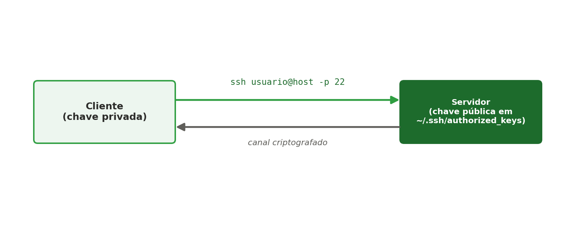

[← Anterior: Semana 2 — Gerenciamento de processos e serviços](../unidade_1/01_semana_02_processos_e_servicos.md) | [Índice](../README.md) | [Próximo: Semana 3 — Permissões e sistema de arquivos →](../unidade_1/03_semana_03_permissoes.md)

# Complemento — Acesso SSH, rede básica e teste de conectividade

> Conteúdo de apoio às Semanas 2-3, usado sempre que for necessário acessar ou testar um servidor remotamente.

## Teoria

O **SSH (Secure Shell)** é o protocolo padrão para acesso remoto e seguro a servidores Linux — substitui protocolos antigos e não criptografados como Telnet. A autenticação pode ser feita por senha ou, de forma mais segura, por **par de chaves** (privada no cliente, pública no servidor).



### Par de chaves: pública e privada

A autenticação por chave usa **criptografia assimétrica**: em vez de uma única senha, são geradas duas chaves matematicamente relacionadas, mas com papéis diferentes:

- **Chave privada**: fica guardada apenas no computador do usuário (ex.: `~/.ssh/id_ed25519`). Nunca deve ser compartilhada, copiada para outra máquina ou enviada por e-mail/chat. É ela que "prova" a identidade do usuário.
- **Chave pública**: pode ser distribuída livremente (ex.: `~/.ssh/id_ed25519.pub`). É copiada para dentro do servidor, no arquivo `~/.ssh/authorized_keys` do usuário remoto.

O funcionamento, de forma simplificada:

1. O cliente pede para se conectar ao servidor.
2. O servidor verifica se existe, no `authorized_keys`, uma chave pública correspondente àquele cliente.
3. O servidor envia um desafio criptografado com a chave pública.
4. Só quem possui a **chave privada** correspondente consegue responder corretamente a esse desafio — sem nunca precisar transmitir a chave privada pela rede.

Por isso esse modelo é mais seguro que senha: mesmo que alguém intercepte toda a comunicação, não há uma senha trafegando que possa ser roubada, e a chave privada nunca sai da máquina do usuário.

> Boas práticas: proteja a chave privada com uma **passphrase** (senha adicional pedida ao usá-la), nunca a compartilhe, e use uma chave diferente por dispositivo/contexto quando possível.

Antes de acessar um servidor, também é importante saber **configurar e diagnosticar a rede**: qual IP a máquina possui, se ela enxerga a internet, se uma porta específica está acessível, etc.

## Comandos essenciais — SSH

No WSL2, o cliente e o servidor SSH normalmente estão na mesma distribuição Linux — por isso, em vez de um IP remoto, usamos `localhost`:

```bash
# 1. Instalar e habilitar o servidor SSH
sudo apt install openssh-server
sudo systemctl enable --now ssh
sudo systemctl status ssh

# 2. Gerar um par de chaves no cliente
ssh-keygen -t ed25519 -C "adriano@ifpe" -N ""
# O -N "" já define a passphrase como vazia, para um acesso totalmente sem senha
# (aceite o caminho padrão apertando Enter na pergunta do local do arquivo)

# 3. Copiar a chave pública para o servidor (autenticação sem senha)
ssh-copy-id seu_usuario@localhost
# Vai pedir a senha do usuário Linux uma última vez

# 4. Conectar — não deve mais pedir nem senha, nem passphrase
ssh seu_usuario@localhost
ssh seu_usuario@localhost -p 2222   # se a porta padrão foi alterada

# 5. Copiar arquivos via SSH (scp)
touch arquivo.txt
scp arquivo.txt adriano@127.0.0.1:~/
```

> **Já criou a chave com passphrase por engano e ela está sendo pedida a cada acesso?** Apague e gere de novo sem passphrase:
> ```bash
> rm ~/.ssh/id_ed25519 ~/.ssh/id_ed25519.pub
> ssh-keygen -t ed25519 -C "adriano@ifpe" -N ""
> ssh-copy-id seu_usuario@localhost
> ```
> Uma passphrase vazia é aceitável em ambiente de estudo/laboratório, mas não é recomendada em servidores de produção — lá, o ideal é manter a passphrase e usar um `ssh-agent` para não digitá-la a cada conexão.

> Se o objetivo for acessar um servidor de verdade em outra máquina da rede, basta trocar `localhost` pelo IP real do servidor (`usuario@192.168.x.x`) — o restante do processo é idêntico. Nesse caso, para acessar o WSL2 a partir de fora, também é preciso configurar port forwarding no Windows (`netsh interface portproxy`), já que o WSL2 usa uma rede NAT interna.

### Usuários com sudo e por que evitar o root

O **root** é o superusuário do Linux — tem acesso irrestrito a todo o sistema. Usar o root diretamente no dia a dia (inclusive para logar via SSH) é uma prática desaconselhada, por alguns motivos:

- **Nenhum limite de segurança**: um erro de digitação em um comando como `rm -rf` executado como root pode destruir o sistema inteiro, sem qualquer proteção.
- **Rastreabilidade**: em um servidor com vários administradores, se todos usam a conta `root`, não dá para saber quem executou o quê. Com usuários individuais, cada ação fica associada a uma pessoa.
- **Superfície de ataque**: o nome de usuário `root` já é conhecido por qualquer atacante — é o primeiro login que tentativas automatizadas de invasão testam. Desabilitar o login SSH do root elimina esse alvo óbvio.

A prática recomendada é criar um **usuário comum com permissão de sudo** — ele executa o dia a dia normalmente como um usuário sem privilégios, e usa `sudo` apenas quando precisa de uma ação administrativa específica, comando a comando.

```bash
# Criar um novo usuário
sudo adduser henrique

# Adicionar esse usuário ao grupo sudo (Ubuntu/Debian)
sudo usermod -aG sudo henrique

# Confirmar que o usuário está no grupo
groups henrique
```

Depois disso, o usuário `henrique` pode rodar comandos administrativos prefixando com `sudo`:

```bash
sudo apt update
sudo systemctl restart nginx
```

**Testando o `PermitRootLogin`**

Por padrão, o acesso SSH via root já **não é permitido**. Antes de mudar qualquer coisa, teste isso na prática:

```bash
ssh root@localhost
```

Esse acesso deve ser recusado. Agora vamos habilitar temporariamente, só para comprovar o comportamento, e depois desfazer.

1. Edite o arquivo de configuração:
```bash
sudo nano /etc/ssh/sshd_config
```

2. Localize a linha `#PermitRootLogin`, remova o comentário e altere para `yes`:
```
PermitRootLogin yes
```

3. Reinicie o serviço e teste novamente:
```bash
sudo systemctl restart ssh.service
ssh root@localhost
```
Agora o acesso deve ser aceito (supondo que a senha do root esteja definida).

4. Volte a configuração para o padrão seguro, alterando de novo para `no`:
```
PermitRootLogin no
```

5. Reinicie o serviço mais uma vez para aplicar:
```bash
sudo systemctl restart ssh.service
```

> A partir desse ponto, qualquer acesso remoto precisa ser feito por um usuário nomeado com sudo — o que também facilita auditoria, já que cada ação fica associada a uma conta específica, e não a um "root" genérico e compartilhado.

## Comandos essenciais — configuração básica de rede

```bash
# Ver endereços IP da máquina
ip addr show
hostname -I          # atalho para o IP no WSL2

# Ver e alterar o hostname
hostname
sudo hostnamectl set-hostname meu-servidor

# Ver a tabela de rotas
ip route

# Ver servidores DNS configurados
cat /etc/resolv.conf
```

### Configurando IP fixo no Ubuntu Server

> Esta seção vale para um **Ubuntu Server real ou em uma VM** (ex.: VirtualBox, Hyper-V, ou um servidor na nuvem) — o WSL2 gerencia sua própria rede virtual internamente e não usa esse método.

O Ubuntu Server (desde a versão 18.04) usa o **Netplan** para configurar rede, com arquivos YAML em `/etc/netplan/`.

1. Identifique o nome da sua interface de rede:
```bash
ip addr show
```
Normalmente algo como `eth0` ou `enp0s3`.

2. Veja o arquivo de configuração existente (o nome pode variar):
```bash
ls /etc/netplan/
sudo cat /etc/netplan/00-installer-config.yaml
```

3. Edite o arquivo para definir um IP fixo:
```bash
sudo nano /etc/netplan/00-installer-config.yaml
```

```yaml
network:
  version: 2
  ethernets:
    eth0:
      dhcp4: no
      addresses:
        - 192.168.1.50/24
      routes:
        - to: default
          via: 192.168.1.1
      nameservers:
        addresses: [8.8.8.8, 8.8.4.4]
```

> Atenção com a indentação no YAML — ela é obrigatória e sensível a espaços (não use tabs).

4. Aplique a configuração:
```bash
sudo netplan apply
```

5. Confirme que o novo IP foi atribuído:
```bash
ip addr show eth0
```

6. Teste a conectividade após a mudança:
```bash
ping -c 4 8.8.8.8
```

## Comandos essenciais — teste de conectividade

```bash
# Testar se um host responde (ICMP)
ping -c 4 google.com

# Testar se uma porta específica está aberta
nc -zv localhost 22
nc -zv localhost 80

# Ver conexões e portas em escuta na própria máquina
ss -tulpn

# Alternativa mais antiga (mas ainda muito usada) ao ss
netstat -natp

# Testar uma requisição HTTP diretamente do terminal
curl -I http://localhost

# Rastrear o caminho até um host (quando disponível no Linux/WSL2)
sudo apt install traceroute
traceroute google.com
```

## Exercícios

1. Habilite o servidor SSH no seu WSL2 e conecte-se a ele localmente usando `ssh usuario@localhost`.
2. Gere um par de chaves SSH e configure o acesso sem senha (`ssh-copy-id`) para o seu próprio usuário local.
3. Use `ss -tulpn` para identificar em quais portas o Nginx (Semana 6) e o SSH estão escutando.
4. Desafio: usando `nc -zv`, escreva um pequeno script que teste a conectividade de 3 portas diferentes (22, 80, 443) e informe quais estão abertas.

---

[← Anterior: Semana 2 — Gerenciamento de processos e serviços](../unidade_1/01_semana_02_processos_e_servicos.md) | [Índice](../README.md) | [Próximo: Semana 3 — Permissões e sistema de arquivos →](../unidade_1/03_semana_03_permissoes.md)
