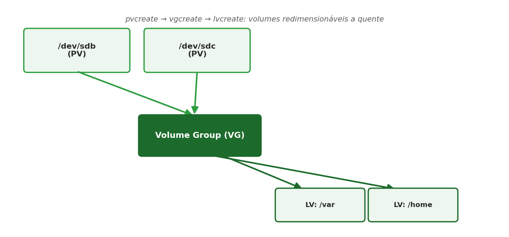

[← Anterior: Semana 3 — Permissões e sistema de arquivos](../unidade_1/03_semana_03_permissoes.md) | [Índice](../README.md) | [Próximo: Semana 5 — Shell scripting para automação →](../unidade_1/05_semana_05_shell_scripting.md)

# Semana 4 — Armazenamento e monitoramento básico

## Teoria

O **LVM (Logical Volume Manager)** permite gerenciar armazenamento de forma flexível, agrupando discos físicos (**Physical Volumes**) em um **Volume Group**, e então criando **Logical Volumes** que podem ser redimensionados a quente.



Os três conceitos-chave do LVM, na ordem em que se relacionam:

- **PV (Physical Volume)**: é a "matéria-prima" — um disco físico inteiro ou uma partição (no nosso caso, um loop device simulando um disco). Sozinho, ainda não é utilizável diretamente pelo LVM; é só a camada de entrada.
- **VG (Volume Group)**: é o "estoque" — um ou mais PVs são agrupados em um único VG, formando um "pool" de espaço de armazenamento combinado. É nesse nível que o espaço de discos diferentes passa a ser tratado como um único volume de armazenamento.
- **LV (Logical Volume)**: é o "produto final" — um pedaço de espaço "recortado" do VG, que é então formatado com um sistema de arquivos (ext4, por exemplo) e montado normalmente, como se fosse uma partição comum. É o LV que o sistema operacional realmente usa no dia a dia.

Ou seja, o caminho é sempre: **disco(s) → PV → VG → LV → sistema de arquivos → ponto de montagem**. A vantagem é que um LV pode ser redimensionado (`lvextend`) puxando espaço livre do VG, mesmo com o sistema em uso — algo que não é possível com uma partição tradicional.

No **WSL2** não existem múltiplos discos físicos disponíveis, então vamos simular usando **arquivos de disco** (loop devices) — os comandos de LVM são exatamente os mesmos que você usaria em um servidor real.

O **journalctl** é a ferramenta de consulta de logs do systemd — centraliza logs do kernel, de serviços e do próprio sistema em um único lugar, permitindo filtrar por serviço, período ou nível de severidade sem precisar caçar arquivos de log espalhados pelo sistema.

## Comandos essenciais — simulando discos no WSL2

```bash
# Criar dois arquivos de 1GB para simular discos
sudo apt install lvm2
sudo dd if=/dev/zero of=/disco1.img bs=1M count=1024
sudo dd if=/dev/zero of=/disco2.img bs=1M count=1024

# Associar os arquivos a loop devices
sudo losetup -fP /disco1.img
sudo losetup -fP /disco2.img
losetup -a   # confirme os nomes atribuídos, ex.: /dev/loop0, /dev/loop1
```

## Comandos essenciais — LVM

```bash
# Criar os Physical Volumes
sudo pvcreate /dev/loop0 /dev/loop1

# Criar o Volume Group
sudo vgcreate meu_vg /dev/loop0 /dev/loop1

# Criar Logical Volumes
sudo lvcreate -L 800M -n lv_dados meu_vg
sudo lvcreate -L 800M -n lv_backup meu_vg

# Formatar e montar
sudo mkfs.ext4 /dev/meu_vg/lv_dados
sudo mkdir /mnt/dados
sudo mount /dev/meu_vg/lv_dados /mnt/dados

# Acompanhar o espaço disponível em cada etapa
df -h

# Redimensionar a quente
sudo lvextend -L +200M /dev/meu_vg/lv_dados
sudo resize2fs /dev/meu_vg/lv_dados

# Conferir o novo tamanho refletido no sistema de arquivos
df -h
```

## Comandos essenciais — journalctl

```bash
# Logs do boot atual
journalctl -b

# Logs de um serviço específico
journalctl -u ssh

# Acompanhar logs em tempo real
journalctl -f

# Logs de um período específico
journalctl --since "2026-08-01" --until "2026-08-10"
```

## Exercícios

1. Simule dois discos, crie um Volume Group e um Logical Volume de 500MB, formate e monte em `/mnt/teste`.
2. Redimensione o Logical Volume criado para 700MB sem desmontá-lo.
3. Use `journalctl -p err` para listar apenas mensagens de erro do sistema.
4. Desafio: pesquise e explique a diferença entre um **snapshot de LVM** e um backup tradicional.

---

[← Anterior: Semana 3 — Permissões e sistema de arquivos](../unidade_1/03_semana_03_permissoes.md) | [Índice](../README.md) | [Próximo: Semana 5 — Shell scripting para automação →](../unidade_1/05_semana_05_shell_scripting.md)
