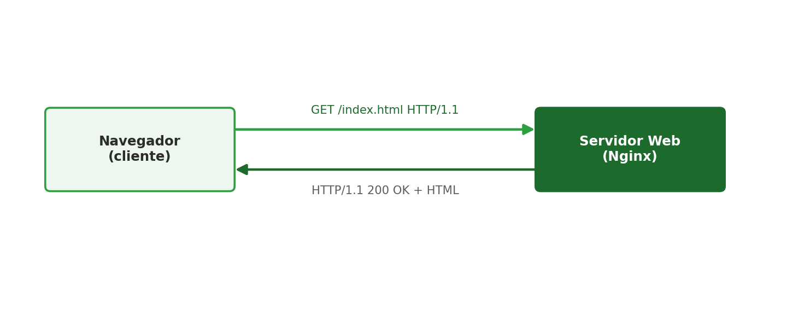
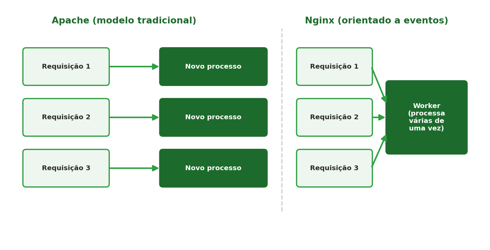

[← Anterior: Semana 5 — Shell scripting para automação](../unidade_1/05_semana_05_shell_scripting.md) | [Índice](../README.md) | [Próximo: Semana 7 — Proxy reverso →](../unidade_1/07_semana_07_proxy_reverso.md)

# Semana 6 — Introdução a servidores web

## Teoria

O protocolo **HTTP** define como clientes (navegadores) e servidores web trocam informações: o cliente envia uma **requisição** (ex.: `GET /index.html`) e o servidor responde com um **status code** e o conteúdo solicitado.



O **Nginx** e o **Apache** são os servidores web mais usados no mercado. O Nginx se destaca por lidar melhor com muitas conexões simultâneas e é frequentemente usado também como **proxy reverso** — um papel adicional que ele desempenha muito bem, e que vamos explorar na próxima semana.

### Apache x Nginx: a diferença na arquitetura

A principal diferença entre os dois está em como cada um lida internamente com múltiplas requisições chegando ao mesmo tempo:



- **Apache (modelo tradicional)**: no modo mais comum (MPM `prefork`), o Apache lança um **novo processo (ou thread) dedicado para cada requisição**. Isso é simples de entender e configurar, mas cada processo consome memória própria — com muitas conexões simultâneas, o servidor pode consumir bastante RAM e ficar mais lento para abrir/gerenciar tantos processos.
- **Nginx (orientado a eventos)**: em vez de um processo por requisição, o Nginx **trabalha com um número fixo de *workers*** (processos), e cada worker consegue atender **várias requisições ao mesmo tempo**, de forma assíncrona e não bloqueante — sem precisar criar um processo novo a cada conexão. É por isso que o Nginx costuma lidar melhor com um volume grande de conexões simultâneas, usando bem menos memória para isso.

Essa diferença de arquitetura explica boa parte das decisões práticas do mercado: o Nginx é frequentemente colocado na "porta de entrada" (servindo arquivos estáticos, fazendo proxy reverso, balanceamento de carga), enquanto o Apache continua muito usado onde sua flexibilidade de módulos (como o `.htaccess`) é mais valorizada — por exemplo, em hospedagens compartilhadas.

> Vídeo recomendado sobre o assunto: [Apache x Nginx](https://www.youtube.com/watch?v=gd_cUmwzgEM)

## Comandos essenciais

```bash
# Instalar o Nginx no WSL2
sudo apt update
sudo apt install nginx

# Como o WSL2 não usa systemd habilitado por padrão em algumas versões, inicie manualmente se necessário:
sudo service nginx start
# ou, com systemd habilitado (ver seção inicial deste material):
sudo systemctl start nginx
sudo systemctl enable nginx
```

Página padrão fica em `/var/www/html/index.nginx-debian.html`. Para servir sua própria página:

```bash
sudo nano /var/www/html/index.html
```

```html
<!DOCTYPE html>
<html lang="en">
<head>
    <meta charset="UTF-8">
    <meta name="viewport" content="width=device-width, initial-scale=1.0">
    <title>Hello World</title>
    <style>
        body {
            font-family: Arial, sans-serif;
            display: flex;
            justify-content: center;
            align-items: center;
            min-height: 100vh;
            margin: 0;
            background: linear-gradient(135deg, #667eea 0%, #764ba2 100%);
        }
        .container {
            text-align: center;
            background: white;
            padding: 2rem;
            border-radius: 10px;
            box-shadow: 0 4px 6px rgba(0, 0, 0, 0.1);
        }
        h1 {
            color: #333;
            margin: 0;
            font-size: 3rem;
        }
        p {
            color: #666;
            margin-top: 1rem;
            font-size: 1.2rem;
        }
    </style>
</head>
<body>
    <div class="container">
        <h1>Hello, World!</h1>
        <p>Welcome to your first web page</p>
    </div>
</body>
</html>
```

Acesse pelo navegador do Windows: `http://localhost`

### Entendendo o arquivo de configuração default

Quando usamos o comando

```bash
nginx -h
```

para verificar os detalhes do Nginx que acabamos de instalar na nossa máquina, vamos observar o local onde ele foi instalado e onde está o arquivo de configuração default que nosso servidorzinho está usando.

> No **WSL2/Ubuntu** (o ambiente deste material), esse arquivo fica em `/etc/nginx/nginx.conf`, diferente do caminho que aparece em instalações via Homebrew no macOS (`/opt/homebrew/etc/nginx/nginx.conf`) — o conteúdo e a lógica do arquivo, porém, são praticamente os mesmos.

```bash
/opt/homebrew/etc/nginx/nginx.conf
```

Veremos que ele se parece com o seguinte:

```nginx
worker_processes  1;

events {
    worker_connections  1024;
}

http {
    include       mime.types;
    default_type  application/octet-stream;

    sendfile        on;

    keepalive_timeout  65;

    server {
        listen       8080;
        server_name  localhost;

        location / {
            root   html;
            index  index.html index.htm;
        }

        error_page   500 502 503 504  /50x.html;
        location = /50x.html {
            root   html;
        }
    }

    include servers/*;
}
```

**Entendendo as configurações**

- **`worker_processes`** — Define o número de processos de trabalho (workers) que o Nginx vai iniciar. Geralmente é definido igual ao número de núcleos de CPU disponíveis, mas aqui está fixado em 1.
- **`worker_connections`** — Define configurações relacionadas aos eventos. O `worker_connections` determina o número máximo de conexões simultâneas que cada processo worker pode aceitar.
- **`http {`** — Início do bloco de configuração do módulo HTTP, que gerencia requisições web.
- **`include mime.types;`** — Inclui o arquivo `mime.types`, que associa extensões de arquivos a tipos MIME, permitindo que o Nginx envie o `Content-Type` correto nas respostas.
- **`default_type application/octet-stream;`** — Define o tipo MIME padrão para arquivos cuja extensão não foi reconhecida. `application/octet-stream` é usado para dados binários genéricos.
- **`sendfile on;`** — Ativa o uso do `sendfile()`, uma chamada de sistema eficiente para envio de arquivos, melhorando a performance.
- **`keepalive_timeout 65;`** — Define o tempo (em segundos) que a conexão ficará aberta aguardando novas requisições antes de ser encerrada.
- **`server {`** — Início do bloco que define um servidor virtual (host).
- **`listen 8080;`** — O servidor irá escutar a porta 8080 por conexões HTTP.
- **`server_name localhost;`** — Define o nome do servidor (hostname) para correspondência com o `Host` da requisição. Neste caso, aceita apenas `localhost`.
- **`location /`** — Define o comportamento para as requisições que chegarem na raiz do `server_name` (`/`).
  - **`root html;`** — Os arquivos serão servidos a partir da pasta `html`.
  - **`index index.html index.htm;`** — Caso não seja especificado um arquivo, tentará carregar `index.html` ou `index.htm`.
- **`error_page 500 502 503 504 /50x.html;`** — Define uma página de erro customizada para os códigos de erro 500, 502, 503 e 504. Redireciona para o caminho `/50x.html`.
- **`location = /50x.html {`** — Especifica onde está localizado o arquivo `/50x.html` no sistema de arquivos, que será servido a partir da pasta `html`.
- **`include servers/*;`** — Inclui todos os arquivos de configuração dentro do diretório `servers/`. Útil para organizar múltiplos blocos `server` separados.

## Exercícios

1. Instale o Nginx e publique uma página HTML estática simples com seu nome e a disciplina.
2. Altere a porta padrão do Nginx (de 80 para 8080) editando `/etc/nginx/sites-available/default` e reinicie o serviço.
3. Rode `nginx -h` e localize, no seu WSL2, onde ficam o binário do Nginx e o arquivo `nginx.conf`.
4. Desafio: instale também o Apache (`apache2`) em outra porta e mantenha os dois rodando simultaneamente sem conflito; compare, em texto, uma vantagem e uma desvantagem do Nginx frente ao Apache.

---

[← Anterior: Semana 5 — Shell scripting para automação](../unidade_1/05_semana_05_shell_scripting.md) | [Índice](../README.md) | [Próximo: Semana 7 — Proxy reverso →](../unidade_1/07_semana_07_proxy_reverso.md)
