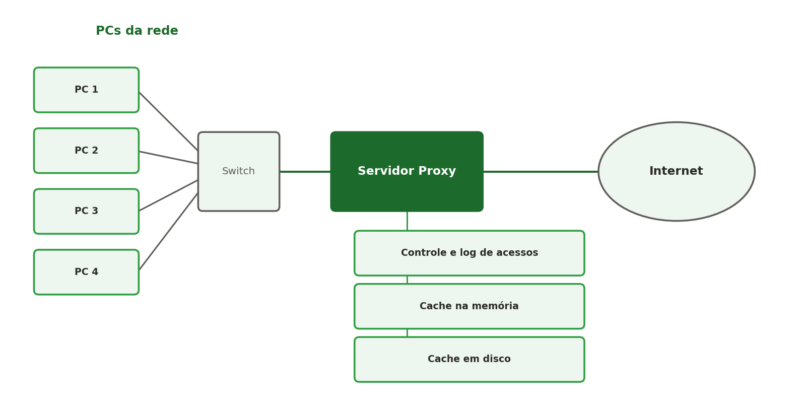
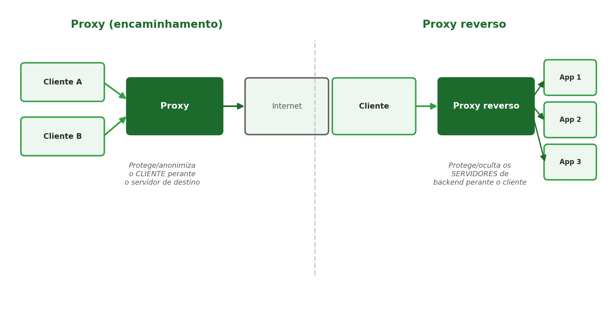
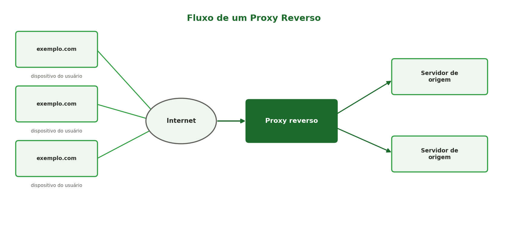
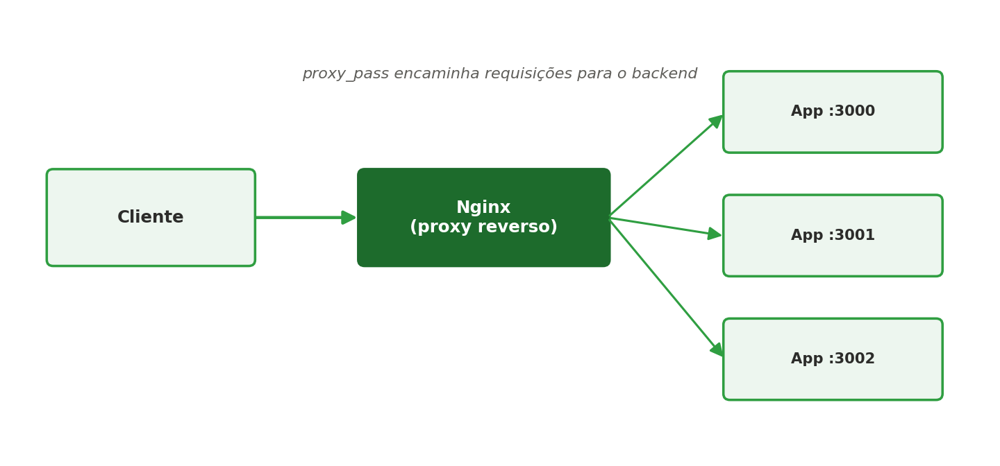
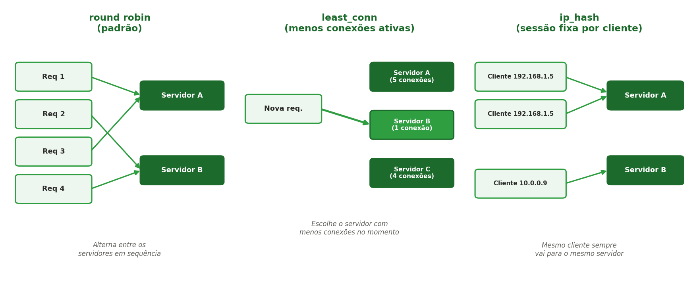

[← Anterior: Semana 6 — Introdução a servidores web](../unidade_1/06_semana_06_servidores_web.md) | [Índice](../README.md) | [Próximo: Semana 8 — TLS/SSL →](../unidade_1/08_semana_08_tls_ssl.md)

# Semana 7 — Proxy reverso

## Teoria

Um **proxy reverso** fica entre o cliente e um ou mais servidores de aplicação, recebendo as requisições e encaminhando-as para o backend correto — sem que o cliente saiba diretamente com qual servidor está falando. Isso é diferente de um **proxy comum (de encaminhamento)**, que fica do lado do cliente: várias máquinas cliente passam por ele para acessar a internet, e é o cliente quem fica "escondido" do servidor de destino.

### Proxy convencional

Um **proxy convencional** fica posicionado entre os computadores de uma rede local e a internet — todo o tráfego de saída passa por ele antes de sair para fora:



Colocado nesse ponto da rede, o proxy convencional normalmente oferece:

- **Controle e log de acessos**: registra quais sites/serviços cada máquina da rede acessou, e pode bloquear acesso a determinados endereços — muito usado em redes corporativas e escolares para aplicar políticas de uso da internet.
- **Cache na memória**: guarda temporariamente, na RAM, conteúdos muito acessados (páginas, arquivos), entregando-os instantaneamente para o próximo PC que pedir o mesmo conteúdo, sem precisar buscar de novo na internet.
- **Cache em disco**: parecido com o cache em memória, mas para conteúdos maiores ou menos acessados, guardados no disco do servidor proxy — mais lento que a memória, porém com muito mais capacidade de armazenamento.

Além de acelerar o acesso (pelo cache) e dar visibilidade/controle sobre o uso da rede (pelos logs), o proxy convencional também permite que muitas máquinas compartilhem um único ponto de saída para a internet — o que facilita aplicar regras de segurança (firewall, filtros de conteúdo) de forma centralizada, em vez de configurar cada PC individualmente.



Em resumo: um **proxy comum protege/anonimiza o cliente**; um **proxy reverso protege/oculta os servidores de backend**. O Nginx, no papel de proxy reverso, fica do lado do servidor — é essa configuração que vamos montar nesta semana.

Pensando no fluxo completo de uma requisição real na internet, o proxy reverso fica posicionado assim:



Vários dispositivos de usuários acessam o mesmo endereço (`exemplo.com`) pela internet; a requisição chega ao proxy reverso, que decide para qual **servidor de origem** (a aplicação de fato) encaminhar cada uma — os usuários nunca sabem, nem precisam saber, com qual servidor de origem estão realmente falando.

No nosso ambiente de estudo, o Nginx desempenha exatamente esse papel de proxy reverso, encaminhando as requisições para a aplicação rodando localmente:



Isso é útil para: distribuir carga entre múltiplas instâncias, ocultar a estrutura interna da infraestrutura, centralizar configurações de segurança (como o TLS, visto na próxima semana), aplicar cache e compressão antes de a requisição chegar à aplicação, e padronizar logs de acesso num único ponto.

## Comandos e configuração — proxy reverso

Suba uma aplicação simples para servir de backend (ex.: um servidor HTTP em Python):

```bash
mkdir ~/app-teste && cd ~/app-teste
python3 -m http.server 3000
```

Configure o Nginx como proxy reverso, editando `/etc/nginx/sites-available/default`:

```nginx
server {
    listen 80;
    server_name localhost;

    location / {
        proxy_pass http://127.0.0.1:3000;
        proxy_set_header Host $host;
        proxy_set_header X-Real-IP $remote_addr;
    }
}
```

Aplique a configuração:

```bash
sudo nginx -t          # testa a sintaxe antes de aplicar
sudo systemctl reload nginx
```

**`systemctl reload` x `nginx -s reload`**: até aqui usamos `systemctl reload nginx`, que pede ao *systemd* para recarregar o serviço. Existe também uma forma de pedir isso **diretamente ao próprio binário do Nginx**, sem passar pelo systemd:

```bash
sudo nginx -s reload
```

Os dois fazem, na prática, a mesma coisa: recarregam os arquivos de configuração **sem derrubar as conexões já em andamento** (diferente de um `restart`, que reinicia o processo inteiro). A diferença é só a "porta de entrada":

- `systemctl reload nginx` — passa pelo systemd, que sabe controlar o serviço (start/stop/enable) mesmo que o Nginx não esteja rodando corretamente; é a forma recomendada quando o Nginx está rodando como serviço gerenciado pelo systemd (como fizemos até aqui).
- `nginx -s reload` — fala diretamente com o processo mestre do Nginx (`-s` de *signal*, envia o sinal internamente). Funciona em qualquer instalação, mesmo sem systemd — é o comando mais comum em ambientes onde o Nginx foi instalado "na mão" (ex.: compilado do código-fonte) ou em sistemas como macOS com Homebrew, onde não há systemd.

Outros sinais aceitos por `nginx -s`:

```bash
sudo nginx -s stop      # para o Nginx imediatamente (sem esperar requisições em andamento)
sudo nginx -s quit      # para o Nginx graciosamente (espera terminar o que já estava em andamento)
sudo nginx -s reopen    # reabre os arquivos de log (útil após rotacioná-los)
```

> No nosso ambiente (WSL2 com systemd habilitado), prefira `systemctl reload/restart nginx` no dia a dia — é a forma mais alinhada com o resto do material (Semana 2). Mas vale saber que `nginx -s` existe e funciona igual, pois é comum encontrá-lo em documentações e tutoriais que não usam systemd.

## Balanceamento de carga com `upstream`

Quando existe mais de uma instância da mesma aplicação rodando (ex.: para suportar mais tráfego ou permitir atualizações sem downtime), o Nginx pode distribuir as requisições entre elas usando a diretiva `upstream`.

### Passo a passo: simulando 3 backends com `http.server`

Antes de configurar o Nginx, precisamos de mais de um "servidor de aplicação" rodando para ele balancear. Uma forma simples de simular isso, sem precisar de uma aplicação de verdade, é subir três instâncias do `python3 -m http.server` — cada uma servindo uma página diferente, para deixar visível qual delas respondeu a cada requisição.

1. Crie três pastas, cada uma com sua própria página:
```bash
mkdir -p ~/lb-teste/app1 ~/lb-teste/app2 ~/lb-teste/app3

echo "<h1>Respondido pelo Servidor 1 (porta 3000)</h1>" > ~/lb-teste/app1/index.html
echo "<h1>Respondido pelo Servidor 2 (porta 3001)</h1>" > ~/lb-teste/app2/index.html
echo "<h1>Respondido pelo Servidor 3 (porta 3002)</h1>" > ~/lb-teste/app3/index.html
```

2. Suba cada uma numa porta diferente, em segundo plano (`&`), para não precisar de três terminais:
```bash
cd ~/lb-teste/app1 && python3 -m http.server 3000 &
cd ~/lb-teste/app2 && python3 -m http.server 3001 &
cd ~/lb-teste/app3 && python3 -m http.server 3002 &
```

3. Confirme que as três estão no ar (cada uma deve responder com um texto diferente):
```bash
curl http://localhost:3000
curl http://localhost:3001
curl http://localhost:3002
```

> Para encerrar os três processos depois dos testes: `kill %1 %2 %3` (referindo-se aos jobs colocados em background), ou `pkill -f http.server`.

Com os três backends no ar, configure o `upstream` do Nginx apontando para eles, editando `/etc/nginx/sites-available/default`:

```bash
sudo nano /etc/nginx/sites-available/default
```

```nginx
upstream meu_backend {
    server 127.0.0.1:3000;
    server 127.0.0.1:3001;
    server 127.0.0.1:3002;
}

server {
    listen 80;
    server_name localhost;

    location / {
        proxy_pass http://meu_backend;
    }
}
```

Aplique a configuração (`sudo nginx -t` e `sudo systemctl reload nginx`) e teste o balanceamento rodando várias requisições seguidas:

```bash
for i in {1..6}; do curl http://localhost; echo; done
```

Como cada porta responde com um texto diferente, fica bem visível o Nginx alternando entre os três servidores em round robin.

Por padrão, o Nginx distribui as requisições em **round robin** (uma para cada servidor, em sequência). Outras estratégias disponíveis:

```nginx
upstream meu_backend {
    least_conn;              # envia para o servidor com menos conexões ativas no momento
    server 127.0.0.1:3000;
    server 127.0.0.1:3001;
}

upstream meu_backend_sticky {
    ip_hash;                 # sempre manda o mesmo cliente para o mesmo servidor (útil para sessões)
    server 127.0.0.1:3000;
    server 127.0.0.1:3001;
}
```



- **round robin** (padrão, sem precisar declarar nada): simples e previsível, mas não leva em conta se um servidor já está mais sobrecarregado que outro.
- **least_conn**: mais justo quando as requisições têm duração muito diferente entre si — evita empilhar tráfego num servidor que já está processando algo pesado.
- **ip_hash**: garante que o mesmo cliente sempre caia no mesmo servidor (chamado de *sticky session*), importante quando a aplicação guarda estado em memória local (ex.: sessão de login) e não teria como recuperar esse estado se a requisição seguinte caísse em outro servidor.

## Health checks e failover

O Nginx também pode marcar um servidor do `upstream` como indisponível automaticamente, e parar de enviar tráfego para ele até que volte a responder:

```nginx
upstream meu_backend {
    server 127.0.0.1:3000 max_fails=3 fail_timeout=30s;
    server 127.0.0.1:3001 max_fails=3 fail_timeout=30s;
    server 127.0.0.1:3002 backup;   # só recebe tráfego se todos os outros falharem
}
```
`max_fails=3 fail_timeout=30s` significa: depois de 3 falhas seguidas, aquele servidor é considerado fora do ar por 30 segundos, período em que o Nginx não tenta mais enviar requisições para ele.

## Cache e compressão

Duas otimizações comuns aplicadas na camada de proxy reverso, antes mesmo de a requisição chegar à aplicação:

```nginx
# Compressão gzip das respostas — reduz o tamanho transferido pela rede
gzip_types text/plain text/css application/json application/javascript;

# Cache de respostas do backend, evitando repetir processamento
proxy_cache_path /var/cache/nginx levels=1:2 keys_zone=meu_cache:10m max_size=100m;

server {
    location / {
        proxy_pass http://meu_backend;
        proxy_cache meu_cache;
        proxy_cache_valid 200 10m;   # respostas com status 200 ficam em cache por 10 minutos
    }
}
```

Se estiver criando o `proxy_cache_path` pela primeira vez, garanta que o diretório de cache existe e tem permissão de escrita:

```bash
sudo mkdir -p /var/cache/nginx
sudo chown -R www-data:www-data /var/cache/nginx
```

E sempre teste antes de recarregar:

```bash
sudo nginx -t
sudo systemctl reload nginx
```

## Logs de acesso e erro

Todo acesso ao Nginx fica registrado por padrão, o que é essencial para investigar problemas e entender o tráfego:

```bash
# Logs de acesso (cada requisição recebida)
sudo tail -f /var/log/nginx/access.log

# Logs de erro (falhas de configuração, proxy indisponível, etc.)
sudo tail -f /var/log/nginx/error.log
```

## Exercícios

1. Suba duas aplicações simples em portas diferentes (3000 e 3001) e configure o Nginx para redirecionar `/app1` para uma e `/app2` para outra.
2. Configure um `upstream` com as duas aplicações do exercício anterior e teste o balanceamento round robin, atualizando a página várias vezes.
3. Configure `max_fails` e `fail_timeout` no `upstream`, derrube uma das aplicações de propósito, e observe pelo `access.log`/`error.log` o Nginx deixando de enviar tráfego para ela.
4. Adicione um cabeçalho de resposta customizado (`add_header`) no Nginx e confirme que ele aparece na resposta usando `curl -I http://localhost`.
5. Explique, em texto, por que normalmente não se expõe a aplicação diretamente à internet, preferindo colocá-la atrás de um proxy reverso.

---

[← Anterior: Semana 6 — Introdução a servidores web](../unidade_1/06_semana_06_servidores_web.md) | [Índice](../README.md) | [Próximo: Semana 8 — TLS/SSL →](../unidade_1/08_semana_08_tls_ssl.md)
