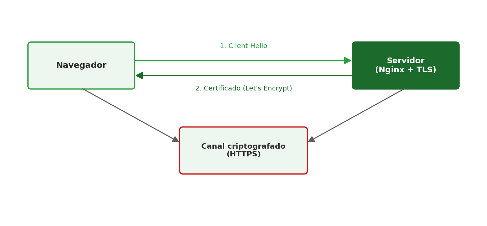
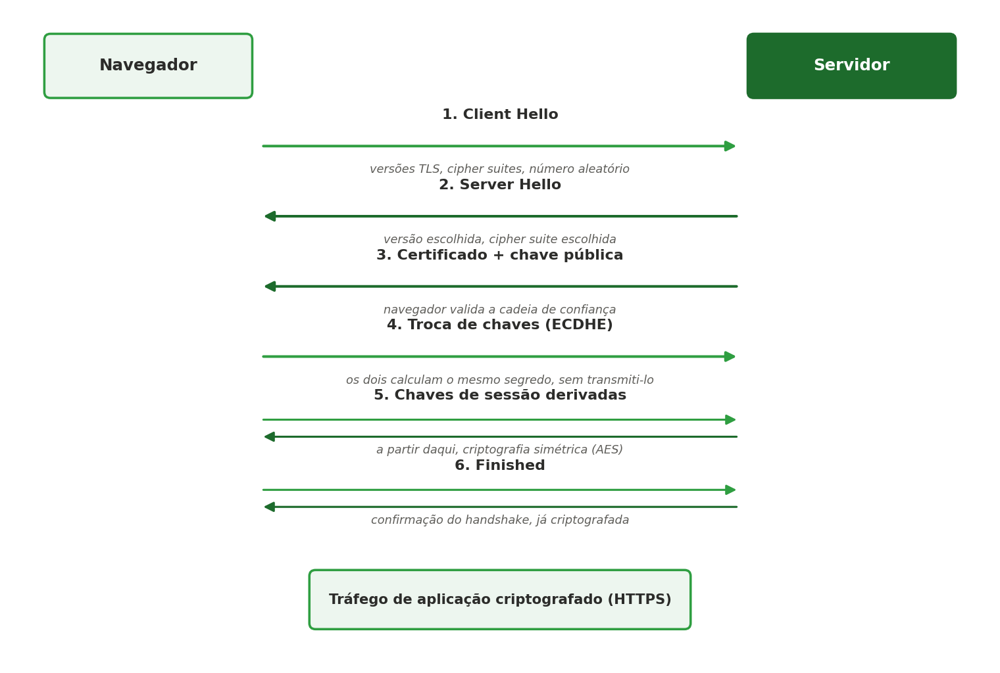

[← Anterior: Semana 7 — Proxy reverso](../unidade_1/07_semana_07_proxy_reverso.md) | [Índice](../README.md) | [Próximo: Checklist geral (Semanas 2 a 8) →](../unidade_1/09_checklist_unidade_1.md)

# Semana 8 — TLS/SSL

## Teoria

O **TLS** (Transport Layer Security, sucessor do SSL) garante que a comunicação entre cliente e servidor seja criptografada e autenticada. É o que torna possível o **HTTPS**.



De forma simplificada: o navegador inicia a conexão, o servidor apresenta um **certificado digital** (emitido por uma autoridade certificadora, como o **Let's Encrypt**), e a partir daí toda comunicação passa a ser criptografada.

### Como funciona o handshake, passo a passo



1. **Client Hello** — o navegador envia as versões de TLS e os algoritmos de criptografia (*cipher suites*) que suporta, além de um número aleatório.
2. **Server Hello** — o servidor escolhe a versão e o algoritmo que serão usados, e envia seu próprio número aleatório.
3. **Certificado** — o servidor envia seu certificado digital (com a chave pública). O navegador valida se ele foi emitido por uma autoridade confiável, se não expirou e se o domínio bate com o acessado.
4. **Troca de chaves** — cliente e servidor combinam matematicamente (via *ECDHE*) um segredo compartilhado, sem nunca transmiti-lo pela rede. O servidor assina essa etapa com sua chave privada, provando ser o dono legítimo do certificado.
5. **Chaves de sessão** — a partir desse segredo, os dois calculam, cada um de forma independente, as mesmas chaves de criptografia **simétrica** (bem mais rápida que a assimétrica usada até aqui).
6. **Finished** — uma última mensagem, já criptografada, confirma que o handshake deu certo. Dali em diante, todo o tráfego da aplicação (o `GET /index.html`, por exemplo) vai criptografado.

Em resumo: a criptografia assimétrica (mais lenta) entra só para **combinar uma chave de forma segura** e **autenticar o servidor**; a criptografia simétrica (mais rápida) cuida do restante da conversa. Tudo isso acontece em milissegundos, antes mesmo da página começar a carregar.

## Comandos essenciais

Para ambientes reais expostos à internet, o **Certbot** automatiza a emissão de certificados Let's Encrypt:

```bash
sudo apt install certbot python3-certbot-nginx
sudo certbot --nginx -d seudominio.com
```

> No WSL2, como normalmente não há um domínio público apontando para a máquina, usamos um **certificado autoassinado** apenas para fins didáticos:

```bash
sudo mkdir -p /etc/nginx/ssl
sudo openssl req -x509 -nodes -days 365 \
  -newkey rsa:2048 \
  -keyout /etc/nginx/ssl/selfsigned.key \
  -out /etc/nginx/ssl/selfsigned.crt \
  -subj "/CN=localhost"
```

Configuração do Nginx para HTTPS (`/etc/nginx/sites-available/default`):

```nginx
server {
    listen 443 ssl;
    server_name localhost;

    ssl_certificate     /etc/nginx/ssl/selfsigned.crt;
    ssl_certificate_key /etc/nginx/ssl/selfsigned.key;

    location / {
        proxy_pass http://127.0.0.1:3000;
    }
}
```

```bash
sudo nginx -t
sudo systemctl reload nginx
```

Acesse `https://localhost` (o navegador vai alertar que o certificado não é confiável — normal para um certificado autoassinado).

### Redirecionamento automático de HTTP para HTTPS

Com os dois ao mesmo tempo no ar (porta 80 e porta 443), é uma boa prática fazer com que quem acessar por HTTP seja **automaticamente redirecionado** para HTTPS, em vez de simplesmente servir o conteúdo sem criptografia nos dois casos.

Edite `/etc/nginx/sites-available/default` e transforme o bloco da porta 80 em um redirecionamento, mantendo o bloco da 443 como já está:

```nginx
server {
    listen 80;
    server_name localhost;

    # Redireciona tudo que chegar por HTTP para a versão HTTPS
    return 301 https://$host$request_uri;
}

server {
    listen 443 ssl;
    server_name localhost;

    ssl_certificate     /etc/nginx/ssl/selfsigned.crt;
    ssl_certificate_key /etc/nginx/ssl/selfsigned.key;

    location / {
        proxy_pass http://127.0.0.1:3000;
    }
}
```

- **`return 301 https://$host$request_uri;`** — responde com um redirecionamento permanente (código 301), mandando o navegador refazer a mesma requisição, só que em HTTPS. `$host` preserva o domínio acessado, e `$request_uri` preserva o caminho e os parâmetros originais da URL.

Aplique e teste:

```bash
sudo nginx -t
sudo systemctl reload nginx

# Confirme o redirecionamento sem seguir automaticamente (-I mostra só os cabeçalhos)
curl -I http://localhost
```

Você deve ver `HTTP/1.1 301 Moved Permanently` na resposta, com um cabeçalho `Location: https://localhost/` apontando para a versão segura.

## Exercícios

1. Gere um certificado autoassinado e configure o Nginx para servir sua aplicação via HTTPS na porta 443.
2. Configure um redirecionamento automático de HTTP (porta 80) para HTTPS (porta 443).
3. Use `openssl x509 -in selfsigned.crt -text -noout` para inspecionar os dados do certificado gerado e identifique a data de validade.
4. Desafio (consolidação da Unidade 1): tendo a aplicação rodando com Nginx, proxy reverso e HTTPS configurados manualmente, documente em um `README.md` todos os passos realizados — esse será a base do seu material de apoio para o seminário avaliativo da semana 9.

---

[← Anterior: Semana 7 — Proxy reverso](../unidade_1/07_semana_07_proxy_reverso.md) | [Índice](../README.md) | [Próximo: Checklist geral (Semanas 2 a 8) →](../unidade_1/09_checklist_unidade_1.md)
