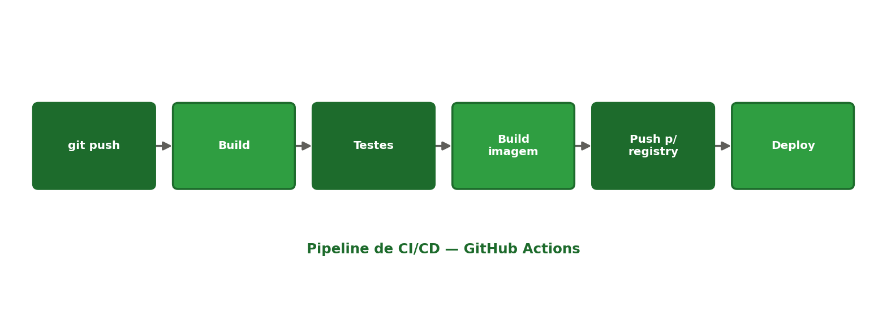

[← Anterior: Semana 12 — Docker Compose](../unidade_2/03_semana_12_docker_compose.md) | [Índice](../README.md) | [Próximo: Semana 14 — Pipeline completo e lançamento do projeto →](../unidade_2/05_semana_14_pipeline_completo.md)

# Semana 13 — Introdução a CI/CD e GitHub Actions

## Teoria

**CI/CD** significa **Integração Contínua** (Continuous Integration) e **Entrega/Implantação Contínua** (Continuous Delivery/Deployment):

- **Integração Contínua**: toda vez que um código é enviado ao repositório, ele é automaticamente construído e testado — detectando problemas cedo, antes de chegarem a produção.
- **Entrega/Implantação Contínua**: o processo de levar essa mudança, já validada, até o ambiente de produção — de forma automatizada, em vez de manual.



O **GitHub Actions** é a ferramenta de CI/CD integrada ao GitHub. Um workflow é definido em um arquivo YAML dentro de `.github/workflows/`, e é disparado por eventos do repositório (um `push`, um `pull request`, etc.).

## Estrutura de um workflow

```yaml
# .github/workflows/ci.yml
name: CI

on:
  push:
    branches: [main]
  pull_request:
    branches: [main]

jobs:
  build-e-testes:
    runs-on: ubuntu-latest

    steps:
      - name: Baixar o código do repositório
        uses: actions/checkout@v4

      - name: Configurar o Python
        uses: actions/setup-python@v5
        with:
          python-version: "3.12"

      - name: Instalar dependências
        run: pip install -r requirements.txt

      - name: Rodar os testes
        run: pytest
```

- **`on`** — define os eventos que disparam o workflow (aqui, `push` ou `pull request` na branch `main`).
- **`jobs`** — um workflow pode ter um ou mais jobs, cada um rodando em uma máquina virtual própria (`runs-on`).
- **`steps`** — a sequência de passos de um job, executados em ordem.
- **`uses`** — reutiliza uma *action* pronta, feita pela comunidade ou pelo próprio GitHub (ex.: `actions/checkout` baixa o código do repositório para a máquina do workflow).
- **`run`** — executa um comando shell diretamente.

## Comandos e fluxo de trabalho

Não há um "comando" para rodar o GitHub Actions localmente — ele roda automaticamente nos servidores do GitHub sempre que o evento configurado acontece. O fluxo de trabalho típico é:

```bash
# 1. Crie a pasta e o arquivo de workflow no seu projeto
mkdir -p .github/workflows
nano .github/workflows/ci.yml

# 2. Adicione, faça commit e envie para o GitHub
git add .github/workflows/ci.yml
git commit -m "Adiciona pipeline de CI"
git push
```

Depois do `push`, acesse a aba **Actions** do repositório no GitHub para acompanhar a execução do workflow em tempo real.

## Exercícios

1. Crie um repositório no GitHub com o projeto da Semana 10 (ou 12) e adicione um workflow simples que só imprime uma mensagem (`run: echo "Rodando CI"`).
2. Adicione um step que instale as dependências do seu projeto e rode algum tipo de verificação (pode ser um teste simples, ou até um `python3 -m py_compile` validando a sintaxe do código).
3. Faça o workflow falhar de propósito (ex.: um comando inexistente) e observe, na aba Actions do GitHub, como o erro é reportado.
4. Desafio: configure o workflow para rodar também quando um `pull request` for aberto, e explique, em texto, por que isso é uma boa prática em equipes.

---

[← Anterior: Semana 12 — Docker Compose](../unidade_2/03_semana_12_docker_compose.md) | [Índice](../README.md) | [Próximo: Semana 14 — Pipeline completo e lançamento do projeto →](../unidade_2/05_semana_14_pipeline_completo.md)
